# Minimol Storage

**Store. Survive. Heal.** Peer-to-peer cloud storage across the laptops you already have.

[](https://github.com/guptakaran0720/Minimol-2026/actions/workflows/ci.yml)

Files are **compressed and encrypted on your machine** before they leave it. Each piece is kept as **3 copies on 3 different laptops**, chosen by **measured, explainable routing**. When a laptop dies or a disk rots, **the survivors repair it on their own**. There is no central server: every node runs the same program.

| | |
|---|---|
| **Compression** | 20 MB sensor CSV stored at **0.30×** its size (laptops and Docker) |
| **Routing** | **0%** of copies placed on a slow node (random baseline: 21.7%); downloads **11.6×** faster than picking a random holder |
| **Delta sync** | **0.85%** of a file sent to re-upload after a 1% edit |
| **Self-healing** | dead laptop detected in **~20 s**; missing copies refilled **6 s** after it rejoined; an empty replacement laptop refilled in **~19 s** |
| **Correctness** | **181 automated tests**, plus a live cluster test; **every self-test passed on 3 real laptops** |

> All numbers are measured, never estimated. Conditions are stated next to each one, and the full method is in [docs/RESULTS.md](docs/RESULTS.md).

## How this README maps to the evaluation rubric

| Criterion | Points | Where to look |
|---|---|---|
| 1. Architectural depth & systems rigor | 30 | [Architecture](#1-architecture-and-systems-rigor): system, node, data flows, metadata and key hierarchy, consistency model, decisions with counter-arguments |
| 2. Core constraint mastery (no AI shortcuts) | 25 | [Core algorithms we built](#2-core-constraints-built-from-first-principles): every algorithm, its formula and the file and line that implements it |
| 3. Edge-case resilience & robustness | 20 | [Failure handling](#3-edge-case-resilience): failure detector, repair protocol, integrity layers, a 26-row edge-case matrix tied to tests, threat model |
| 4. Quantitative performance & optimization | 15 | [Measured results](#4-measured-performance): five charts, three test environments, A/B against baselines, reproduction commands |
| 5. UX polish & demonstration quality | 10 | [Dashboard and demo](#5-dashboard-and-demonstration): live dashboard, cluster timeline, 5-minute demo with fallbacks |

---

## 1. Architecture and systems rigor

### 1.1 The system: every node is equal

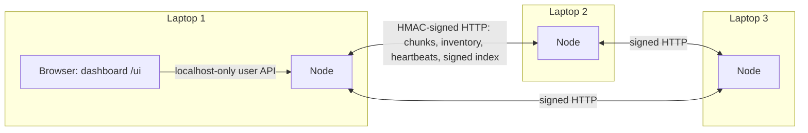

- **No coordinator, no tracker, no metadata server.** Each node stores chunks for others, uploads its own files, detects failures and runs repair.
- **Discovery:** a seed address, then `/peers` gossip every 5 s and optional mDNS. Knowing one peer is enough to find all of them.
- **Transport:** plain HTTP on any IP network (LAN, hotspot or a mesh VPN, see [docs/TAILSCALE.md](docs/TAILSCALE.md)).
- **Authentication:** every peer request and every response is HMAC-signed with the cluster key over method, path, node, timestamp and body hash, and accepted only within ±30 s.

### 1.2 Inside one node

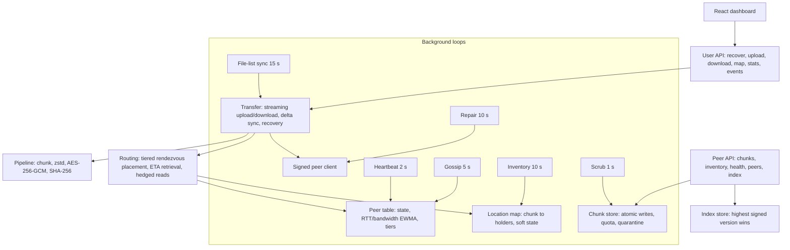

The node is about 3,100 lines of Python ([`node/`](node/)) behind frozen interfaces in [`node/contracts.py`](node/contracts.py). That let four people build the parts in parallel against in-memory fakes.

### 1.3 Upload: compress, encrypt, place, publish

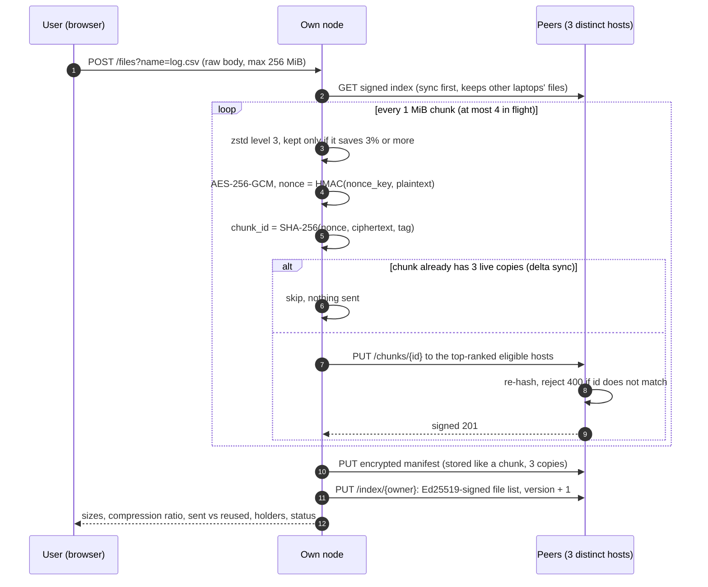

### 1.4 Download: fastest holder, hedged, verified twice

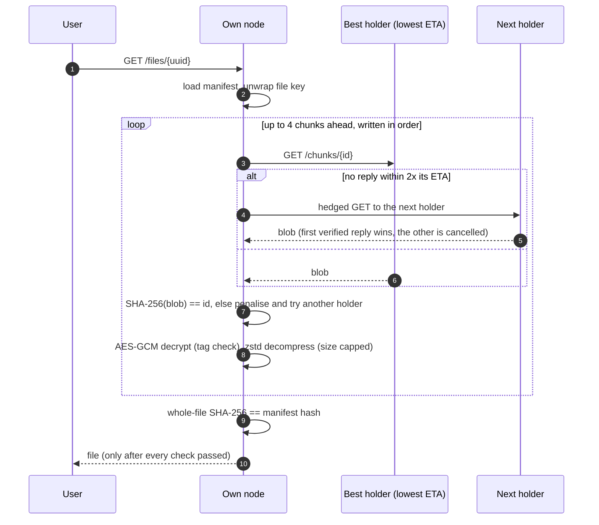

### 1.5 Metadata model: immutable manifests, soft-state locations

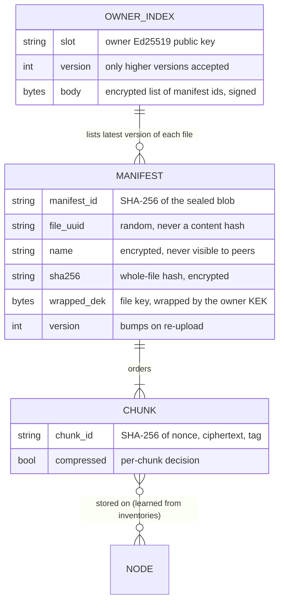

- **Manifests never change after upload,** so there are no concurrent-update conflicts on them.
- **Chunk locations are not stored anywhere permanent.** Every node pulls each peer's inventory every 10 s. A dead peer keeps its last inventory, which is exactly how repair sees the missing copy.

### 1.6 Keys: nothing secret ever leaves the owner

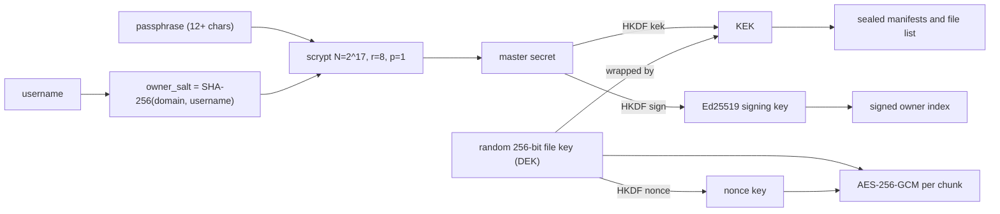

- **A fresh laptop needs only the username and passphrase.** The salt comes from the username, so there's no key file to copy.
- **Peers store only ciphertext and signed records.** A wrong passphrase derives different keys and sees no files, which we tested on all 3 laptops.

### 1.7 Consistency and failure model

| Property | What we guarantee | What we don't claim |
|---|---|---|
| Chunk integrity | A corrupt or forged chunk is never accepted: re-hashed by the storer, by the downloader and by the background scrubber; plus the GCM tag and the whole-file SHA-256 | — |
| Replication | Each chunk targets 3 copies on 3 distinct `host_id`s. Upload reports `durable` or `degraded` honestly | Survival of 3 simultaneous host losses |
| Repair | Never reduces the number of copies; a race can only over-replicate | Garbage collection of extra copies (planned) |
| File list | Highest valid signed version wins; every unlocked laptop re-syncs every 15 s | Merging two devices that upload at the same instant (single-writer; the upload reports `index_acks`) |
| Availability | Reads go to any live holder; works with 2 of 3 laptops down | Internet-wide operation without a VPN (NAT traversal planned) |

### 1.8 Decisions, with the strongest counter-argument

Every choice was attacked before it was kept. The full reasoning is in [docs/ARCHITECTURE_DECISIONS.md](docs/ARCHITECTURE_DECISIONS.md).

| Decision | Alternative rejected | Why |
|---|---|---|
| 3 full copies | Erasure coding (2-of-4) | With 4 hosts there's no spare host to rebuild a share. Revisit at 8+ nodes. |
| Per-chunk compress, then encrypt | Whole-file | Bounded memory, per-chunk integrity check, a hard decompression cap, mixed-content files handled |
| Ciphertext-addressed chunks, random file IDs | Convergent encryption | Convergent encryption leaks "do you have this file?" |
| Fixed weights in placement | Live score in weights | Live weights churn placement and cause repair storms |
| ETA = RTT + size ÷ bandwidth | Weighted sum of metrics | One unit (seconds), no arbitrary weights to defend |
| Peer-driven repair with an elected leader | Uploader-driven repair | Works when the uploader is gone |
| Soft-state locations | Holder lists in the manifest | Manifests stay immutable; no update conflicts |

---

## 2. Core constraints, built from first principles

**No AI or ML is used anywhere in the data path.** Routing, placement, repair and failure detection are deterministic, explainable algorithms that we implemented and tested ourselves. Libraries supply only primitives: zstd, AES-GCM, SHA-256, HKDF, scrypt, Ed25519, and the HTTP server.

| Constraint | Our algorithm | Formula / rule | Code |
|---|---|---|---|
| Client-side compression | Per-chunk zstd, kept only if it pays | keep if `len(z) ≤ 0.97 × len(plain)` | [`pipeline.py:65`](node/pipeline.py#L65) |
| Client-side encryption | AES-256-GCM with a synthetic nonce | `nonce = HMAC(HKDF(DEK,"nonce"), flag‖plain)[:12]`, `AAD = file_uuid‖flag` | [`pipeline.py:56`](node/pipeline.py#L56) |
| Content addressing | Chunk ID is the hash of its ciphertext | `id = SHA-256(nonce‖ct‖tag)` | [`pipeline.py:65`](node/pipeline.py#L65) |
| Smart placement | Tiered weighted rendezvous hashing, distinct hosts | `key = −w / ln(u)`, `u = (H(chunk:node) + 0.5) / 2⁶⁴`; P(first) = `w / Σw` | [`routing.py:30`](node/routing.py#L30), [`routing.py:36`](node/routing.py#L36) |
| Smart retrieval | Rank holders by estimated fetch time | `ETA = rtt_ewma + size / bw_ewma`, EWMA α = 0.3, median priors | [`routing.py:62`](node/routing.py#L62) |
| Tail latency | Hedged reads | 2nd request after `max(50 ms, 2 × ETA)`; first verified reply wins | [`transfer.py:289`](node/transfer.py#L289) |
| Slow-peer detection | Tiering with hysteresis | tier 2 if `ETA > 3 × median` for 30 s; same to return | [`peers.py:144`](node/peers.py#L144) |
| Failure detection | Heartbeat state machine | suspect after 2 misses or a failed transfer; dead after 20 s silence | [`peers.py:116`](node/peers.py#L116) |
| Self-repair | Deterministic leader, takeover | leader = live holder with max `u`; rank k acts after 2k short rounds | [`repair.py:74`](node/repair.py#L74), [`routing.py:101`](node/routing.py#L101) |
| Bit-rot defence | Background scrubbing | re-hash 8 chunks/s; quarantine on mismatch; normal repair restores | [`chunkstore.py:114`](node/chunkstore.py#L114), [`scrub.py:22`](node/scrub.py#L22) |
| Recovery | Passphrase-derived keys + signed index | `scrypt(pw, SHA-256(user))` → HKDF → KEK, Ed25519 | [`keys.py:62`](node/keys.py#L62), [`index.py:51`](node/index.py#L51) |
| Peer auth | HMAC request and response signing | `HMAC(key, method‖path‖node‖ts‖H(body))`, ±30 s | [`auth.py:23`](node/auth.py#L23) |
| Delta sync | Deterministic encryption per file | same name → same DEK → unchanged chunk → same ID → skip | [`transfer.py:105`](node/transfer.py#L105) |

**Proof the algorithms behave as claimed** (from [`tests/test_routing.py`](tests/test_routing.py)):
- `test_weight_controls_first_choice_share`: weights 1:3 give the heavy peer 75% ± 4% of first choices over 4,000 chunks.
- `test_removing_a_non_winner_does_not_move_chunks`: when a peer leaves, only the chunks it held move.
- `test_slow_tier_never_chosen_while_three_healthy_hosts_exist`.

---

## 3. Edge-case resilience

### 3.1 Failure detector

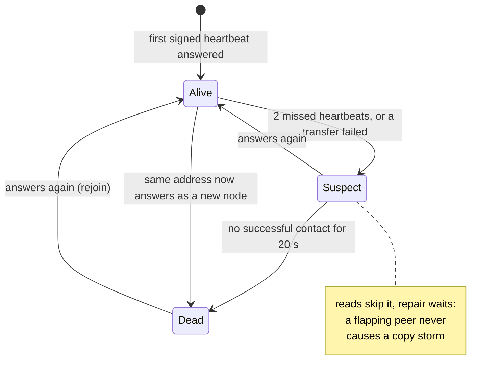

### 3.2 Repair protocol

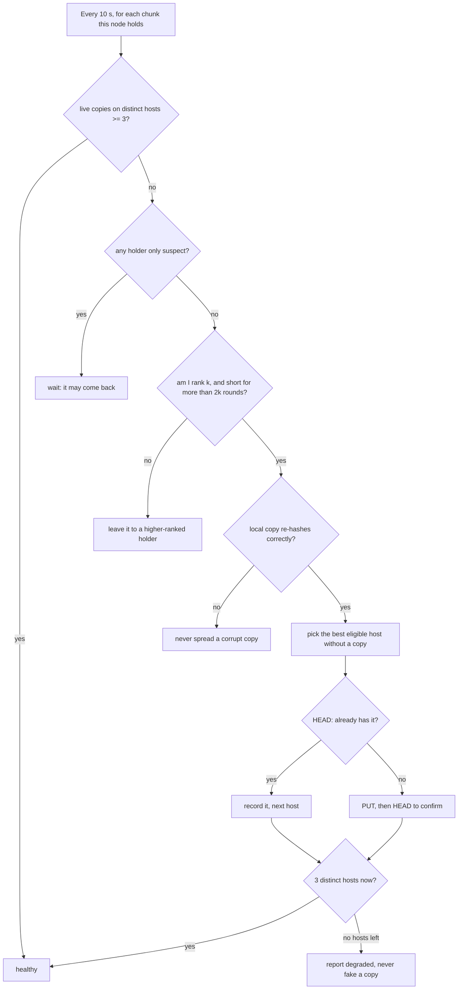

### 3.3 Five independent integrity checks

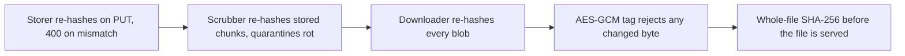

### 3.4 Edge-case matrix

| # | Situation | What the system does | Proof |
|---|---|---|---|
| 1 | Holder dies during a download | Tries the next holder; 1 s connect timeout | `test_download_survives_one_dead_holder`; laptops 8/8 |
| 2 | Two holders down | Downloads from the last copy | `test_download_survives_two_dead_hosts_with_r3`; laptops |
| 3 | Holder returns wrong bytes | Hash mismatch; peer penalised; next holder | `test_corrupt_holder_is_skipped_and_penalised`; tamper test 3/3 laptops |
| 4 | Silent bit rot on disk | Scrubber quarantines; repair restores a good copy | `test_scrub_quarantines_corrupt_chunk_and_accepts_a_good_copy_again` |
| 5 | Holder stalls without failing | Hedged read to the next holder | `test_hedged_read_beats_a_stalled_holder` |
| 6 | Location map out of date | Asks every live peer before giving up | `test_stale_location_map_falls_back_to_asking_everyone` |
| 7 | Only 2 hosts left | Stores 2 copies and reports **degraded**, never a fake third | `test_upload_with_two_hosts_is_degraded_not_failed`; laptops |
| 8 | No peer accepts a chunk | 503, nothing half-published | `test_upload_with_no_peers_raises` |
| 9 | Every holder gone | File reported **unavailable**, never hidden | `test_all_holders_gone_is_unavailable` |
| 10 | Peer's disk full | 507; next-ranked host used | `test_full_peer_is_skipped_for_next_ranked`, `test_quota` |
| 11 | Two nodes repair the same chunk | Idempotent PUT: over-replicate, never under | `test_racing_repairers_never_under_replicate` |
| 12 | Repair leader silently dead | Next holder takes over after 2 rounds | `test_follower_takes_over_after_two_rounds_when_leader_is_silent` |
| 13 | Peer flapping | Repair waits while it's only suspect | `test_suspect_holder_delays_repair` |
| 14 | Corrupt local copy at repair time | Not copied anywhere | `test_corrupt_local_copy_is_not_spread` |
| 15 | Laptop restarts with a new ID | Old ID retired at once | `test_restarted_node_with_new_id_replaces_old` |
| 16 | Empty file, exact multiple of 1 MiB | 0 chunks / no trailing chunk | `test_empty_file_has_no_chunks`, `test_exact_multiple_has_no_trailing_chunk` |
| 17 | Socket gives short reads | Chunk boundaries stay fixed, delta still works | `test_short_reads_keep_fixed_chunk_boundaries` |
| 18 | Decompression bomb | Rejected before decompressing (declared size > 1 MiB) | `test_decompression_bomb_rejected`, `test_frame_without_content_size_rejected` |
| 19 | Chunk moved to another file | AAD mismatch, rejected | `test_wrong_key_file_or_flag_rejected` |
| 20 | Forged or rolled-back file list | Signature check; highest valid version | `test_tampered_record_rejected`, `test_rollback_defence_picks_highest_valid` |
| 21 | Wrong passphrase / other user | Different keys: 0 files, nothing decrypts | `test_recover_ignores_forged_index_wrong_passphrase_and_other_user`; laptops 3/3 |
| 22 | Manifest unreachable during recovery | Restores the rest, retries every 15 s | `test_recover_skips_a_manifest_no_peer_can_serve` |
| 23 | Another device published the list first | Reported as `index_acks = 0` | `test_upload_reports_how_many_peers_took_the_index` |
| 24 | Upload from another laptop | Appears here within 15 s | `test_sync_loop_picks_up_files_uploaded_elsewhere`; Docker 15.1 s |
| 25 | Outsider without the cluster key | Every request and response rejected; never joins | `test_hmac_rejection`, `test_unsigned_or_impostor_responses_rejected`; laptops 3/3 |
| 26 | Replayed request / response | Outside ±30 s or wrong signature → rejected | `test_timestamp_window`, `test_replayed_response_rejected` |

### 3.5 Threat model (summary)

| Threat | Mitigation | Status |
|---|---|---|
| Peer reads your data | Client-side AES-256-GCM; peers hold ciphertext; names and hashes only inside sealed manifests | Done |
| Peer tampers with data | Five integrity checks (§3.3) | Done |
| Fake node joins | HMAC on every request and response | Done (closed membership) |
| Disk exhaustion / huge upload | Quotas (507), body caps (413), 256 MiB upload limit | Done |
| Peer lies about storing a chunk | Inventory + HEAD at repair + slow-tier probes + local scrub | Partial; challenge audits planned |
| Traffic sniffing | Payloads already encrypted; mutual TLS planned | Partial |

---

## 4. Measured performance

Three environments, each stated on its chart:
1. a **4-node Docker cluster** (A/B tests with a simulated 300 ms slow node),
2. **4 local processes**,
3. **3 real laptops on campus Wi-Fi**.

Medians of 5 runs unless noted. Full tables in [docs/RESULTS.md](docs/RESULTS.md).

<p align="center">
  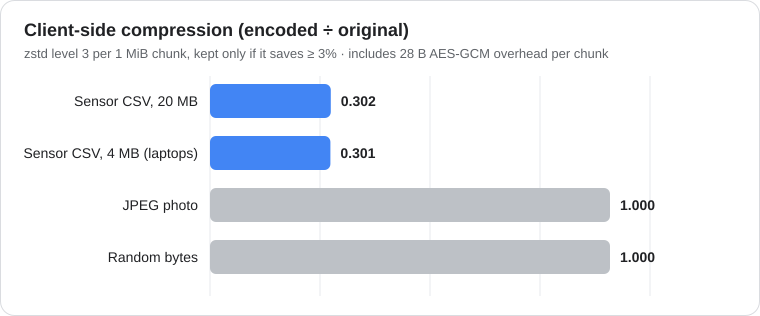
</p>

<p align="center">
  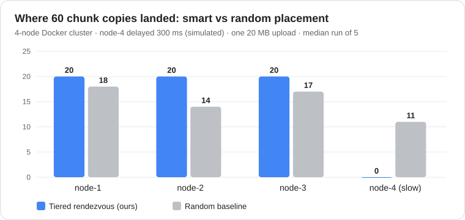
</p>

<p align="center">
  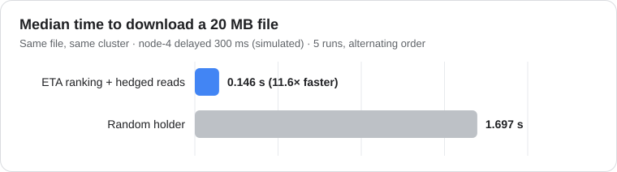
</p>

<p align="center">
  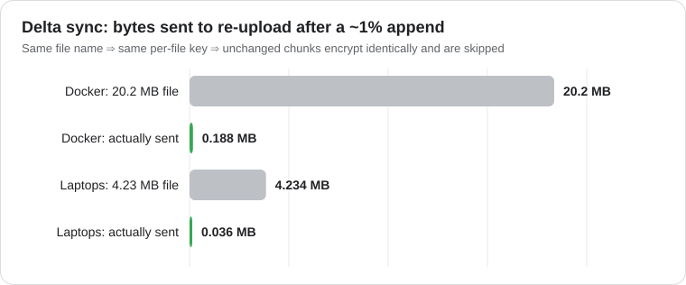
</p>

<p align="center">
  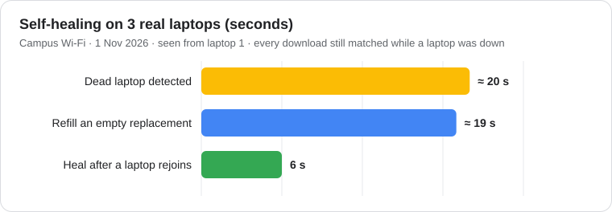
</p>

### Where the time and bytes go
- **Storage cost:** 3 copies × 0.30 compression = **0.90×** the original size for compressible data, i.e. less than one plain copy. Incompressible data costs 3.0×, which is the price of surviving two failures.
- **Memory:** at most 4 chunks in flight, about 4 MiB, whatever the file size. The upload is spooled to disk, never held in RAM.
- **Network:** delta sync and repair move only missing chunks. Hedged reads add a second request only for the slow tail, after 2× ETA.

### Reproduce
```bash
docker compose up -d --build && scripts/docker_e2e.sh       # cluster test + live A/B benchmark
python -m bench.bench --sim                                 # checks the benchmark script itself
.venv/bin/python -m pytest -q                               # 181 tests
python3 docs/img/make_charts.py                             # redraw these charts from RESULTS.md
```

---

## 5. Dashboard and demonstration

Every node serves a React dashboard at `http://localhost:8000/ui/`, polling every 2 s. It shows:
- **Peers:** live state, slow tier, RTT, bandwidth, free space.
- **Unlock and recover:** shows what an unlock found, and warns on a likely typo.
- **Upload card:** compression, sent vs reused chunks, durable or degraded.
- **File list:** health badges, and downloads verified by SHA-256.
- **Chunk map:** which laptop holds each piece.
- **Self-repair panel**, and a **live cluster timeline** (peer joins, suspects, deaths, scrub quarantines, repair copies).

### The 5-minute live demo (3 laptops)

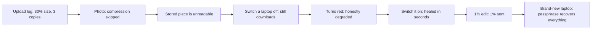

**Timed script, judge questions and fallbacks:** [docs/DEMO_SCRIPT.md](docs/DEMO_SCRIPT.md). **Plan B:** the same demo on the Docker cluster. **Pitch deck:** [docs/Minimol_Storage_Pitch.pptx](docs/Minimol_Storage_Pitch.pptx).

---

## Run it

### Docker (one machine, 4 nodes)
```bash
docker compose up -d --build        # dashboard: http://localhost:8001/ui/
docker compose stop node3           # watch it turn red after ~20 s, then the files heal
```
More in [docs/DOCKER.md](docs/DOCKER.md).

### Real laptops (same network, or Tailscale across networks)
```bash
python3 -m venv .venv && .venv/bin/pip install -r requirements.txt
(cd ui && npm ci && npm run build)
CLUSTER_KEY=<shared secret, 16+ chars> NODE_ID=laptop-1 HOST_ID=laptop-1 ADVERTISE_ADDR=<my ip>:8000 \
  .venv/bin/python -m node.main                              # laptop 1 (seed)
CLUSTER_KEY=<same> NODE_ID=laptop-2 HOST_ID=laptop-2 ADVERTISE_ADDR=<my ip>:8000 SEEDS=<laptop-1 ip>:8000 \
  .venv/bin/python -m node.main                              # every other laptop
```
Then open `http://localhost:8000/ui/` and unlock with a username and a passphrase of 12+ characters.

- **Connectivity check:** `curl http://<ip>:8000/health` from another laptop must return 401 (reachable, unsigned request rejected).
- **Across networks:** see [docs/TAILSCALE.md](docs/TAILSCALE.md).

## Documentation

| Read | For |
|---|---|
| [docs/explain/](docs/explain/) | One page per part, written to be explained out loud |
| [docs/ARCHITECTURE_DECISIONS.md](docs/ARCHITECTURE_DECISIONS.md) | Every design choice, its strongest counter-argument, and the verdict |
| [docs/RESULTS.md](docs/RESULTS.md) | Every measurement, its method and conditions |
| [docs/JUDGE_QA.md](docs/JUDGE_QA.md) | 110 judge questions with answers, follow-ups and limits |
| [docs/DEMO_SCRIPT.md](docs/DEMO_SCRIPT.md) | The timed 3-laptop demo |
| [docs/TEAM_WORKFLOW.md](docs/TEAM_WORKFLOW.md) | How four people built it in parallel |

## Repository

```
node/        pipeline, keys, manifest, index (P1) · chunkstore, peers, api_peer, discovery, scrub, events (P2)
             routing, transfer, repair, api_user (P3) · main.py wires a node together
ui/          React dashboard (Vite + TypeScript)
bench/       live and simulated benchmarks with A/B baselines
tests/       181 unit tests, in-memory fakes, live cluster test
scripts/     run_cluster.sh, docker_e2e.sh
docs/        decisions, explanations, results, Q&A, demo, deck, charts
```

## Limits and roadmap

| Today | Next |
|---|---|
| One network, or a mesh VPN | Kademlia DHT + relays for direct internet use |
| 3 full copies (0.90× after compression, 3× for incompressible data) | Erasure coding with zfec at 8+ nodes |
| Extra copies are never deleted | Garbage collection of unreferenced chunks |
| Peer links signed, not encrypted (the data is) | Per-node identities with mutual TLS |
| Inserting bytes breaks delta sync | Content-defined chunking (FastCDC) |
| One writer per owner at a time | Mergeable (CRDT) file list |

## Team

| Role | Owns |
|---|---|
| P1 | Crypto + data: pipeline, keys, manifests, signed index, dashboard |
| P2 | Node + network: chunk store, peer API, heartbeats, inventory, discovery, scrubbing |
| P3 | Routing + repair: placement, retrieval, transfer, repair, user API, benchmark |
| P4 | Story + demo: explanations, Q&A, demo script, results, deck |
