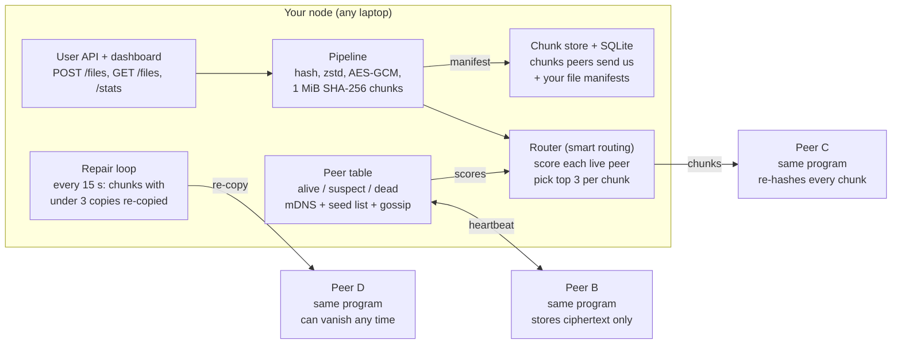

# P2P Cloud Storage — Hackathon Research & Build Guide

*Problem statement: "Standalone peer-to-peer cloud storage with client compression and smart routing."*
*Last updated: 1 Nov 2026*

## Contents

- [TL;DR](#tldr)
- [1. Understand the problem](#1-understand-the-problem)
- [2. Existing projects](#2-existing-projects)
- [3. Architecture options](#3-architecture-options)
- [4. Recommended design](#4-recommended-design)
- [5. Feasibility assessment](#5-feasibility-assessment)
- [6. Build plan (10 hours)](#6-build-plan-10-hours)
- [7. Reading list and sources](#7-reading-list-and-sources)

## TL;DR

Build a LAN-first network of 3–4 Python nodes with no central server. Each file is compressed with Zstandard, encrypted with AES-GCM, split into 1 MiB chunks named by their SHA-256 hash, and stored on the 3 best-scoring peers. Kill any node during the demo and the file still downloads, then the system re-copies the missing chunks by itself.

| Decision | What we pick today | Why |
| --- | --- | --- |
| Architecture | LAN peer-to-peer; every node is equal; mDNS discovery with a typed seed list as backup | Works on one hotspot, no NAT traversal, easy to debug |
| Language and stack | Python 3.11, FastAPI + uvicorn, httpx, zstandard, cryptography, zeroconf, SQLite | Each library is one `pip install`, and you can read every request in a browser |
| Compression | Zstandard level 3, skipped for files that are already compressed | Fast, good ratio, Python bindings ready |
| Redundancy | 3 full copies of every chunk | Simple; survives 2 lost peers per chunk; erasure coding later |
| Smart routing | Weighted score (uptime, latency, free space, bandwidth, failures) + weighted rendezvous hashing for placement | Explainable in one slide, visible on the dashboard |
| Demo story | Upload → see compression and where chunks went → kill a node → still download → watch auto-repair | Shows every word of the problem statement in 5 minutes |

Brutally honest scope: the MVP plus a strong prototype fit in 8–10 hours if you **skip** internet-wide NAT traversal, a DHT, erasure coding, and any blockchain or AI. Those are future scope, and judges accept that when the core works live.

## 1. Understand the problem

The problem asks for a cloud drive with no cloud company behind it: ordinary computers store pieces of each other's files, the uploader's own machine shrinks the file first, and the system picks the best peers to store and fetch from.

### 1.1 What P2P cloud storage is

**Analogy.** Google Drive is a bank locker: one company, one building, one key-holder. P2P storage is a group of friends who each keep a few sealed envelopes for you. You keep a notebook listing which friend holds which envelope. If one friend is away, two others have the same envelope.

| | Traditional cloud (Drive, S3) | P2P cloud storage |
| --- | --- | --- |
| Who runs the disks | One company's data centres | Every participant's spare disk |
| Single point of failure | The provider (outage, account ban, price change) | None if data is copied to enough peers |
| How you find a file | A location: URL or bucket path | Its content: the hash of the bytes |
| Privacy | Provider can read data unless you encrypt | Peers see only encrypted chunks |
| Hard parts | Paying for it | Peers come and go, finding peers, NAT/firewalls, keeping enough copies |

The technical words you will meet:

- **Node / peer**: one running copy of our program on one computer. It both stores chunks for others and uploads its own.
- **Chunk**: a fixed-size piece of a file (we use 1 MiB). Small pieces spread load and let downloads run in parallel.
- **Content addressing**: a chunk's name is the SHA-256 hash of its bytes. Anyone can re-hash what they received and know at once if it was corrupted. IPFS is built on this idea.
- **Replication factor (R)**: how many peers hold each chunk. R = 3 survives 2 failures.
- **Erasure coding**: a smarter alternative to full copies. Split into k data pieces plus extra parity pieces so any k of n rebuild the file (Tahoe-LAFS defaults to 3 of 10). Less disk than copies, more code. Future scope for us.
- **Manifest**: the notebook. A small JSON record per file: name, size, compression used, chunk hashes in order, and who holds each chunk.
- **Discovery**: how a new peer finds the others. On a LAN, mDNS broadcasts "I'm here". On the internet you need a bootstrap server or a DHT.
- **DHT (distributed hash table)**: a phone book split across all peers, so no single server knows everything. Kademlia is the standard design.
- **NAT**: home and campus routers hide many devices behind one public IP, so outside peers cannot dial in directly. This is why internet P2P is much harder than LAN P2P.
- **Heartbeat**: a small "are you alive?" request every few seconds. It tells you who is online and how fast they answer.

### 1.2 What client-side compression is

**Analogy.** Vacuum-pack your clothes before you ship them. You do it at home, so the courier and every warehouse handle a smaller box.

"Client-side" means the uploader's machine compresses before anything leaves it. Every peer then stores fewer bytes and the network carries fewer bytes. Peers never need to see the original data.

The order matters: **compress → encrypt → chunk**. Encrypted bytes look random, and random bytes do not compress, so compressing after encryption saves nothing.

| Algorithm | Speed | Ratio | Best for | Verdict for us |
| --- | --- | --- | --- | --- |
| [Zstandard (zstd)](https://github.com/facebook/zstd) | Very fast both ways; tunable levels | Similar to or better than zlib at default level | General files, real-time use | **Pick this** (level 3 default) |
| [LZ4](https://lz4.github.io/lz4/) | Fastest, especially decompression | Lower | Very fast links, CPU-weak devices | Good "speed mode" option |
| zlib / gzip | Much slower than zstd | Similar to zstd default | Compatibility | Fallback only (built into Python) |
| Brotli / xz (LZMA) | Slow at high levels | Highest | Archives, web assets compressed once | Too slow for live uploads |

In the zstd project's own lzbench table (Silesia corpus), zlib level 1 compresses at about 105 MB/s while zstd's fast mode runs at about 545 MB/s, with zstd decompression near 1,850 MB/s ([zstd README via ecosyste.ms](https://awesome.ecosyste.ms/projects/facebook.github.io%2Fzstd%2F)). Zstd's format is standardised as RFC 8878.

**When to skip compression:** JPEG, PNG, MP4, MP3, ZIP, and Office files (.docx/.xlsx are ZIP inside) are already compressed. Compressing them again costs CPU and gains nothing. Rule: skip known extensions, and for everything else trial-compress the first 256 KB; if it shrinks by less than 10%, store it raw and mark that in the manifest.

### 1.3 What smart routing is

**Analogy.** Choosing delivery partners. You prefer the ones who always show up (uptime), live nearby (latency), have space in the van (free storage), and were fast last time (bandwidth). You avoid the one who just failed a delivery.

Smart routing makes two decisions:

1. **Placement (upload):** which R peers should hold each chunk?
2. **Retrieval (download):** of the peers holding a chunk, which one do we ask first?

| Signal | How we measure it | Why it matters |
| --- | --- | --- |
| Uptime | Share of the last 60 heartbeats answered | A peer that is often offline loses your chunks |
| Latency | Round-trip time of each heartbeat, smoothed (moving average) | Faster responses, faster transfers |
| Free space | Reported by the peer in its heartbeat reply | A full peer cannot store the chunk |
| Bandwidth | Bytes / seconds of recent real chunk transfers, smoothed | Big files finish sooner |
| Recent failures | Count of failed uploads/downloads in the last 5 minutes | Avoid flaky peers quickly |

Each peer gets one score between 0 and 1 (weights are a starting guess you can tune):

```math
\text{score} = 0.35\,U + 0.25\,\frac{1}{1 + \text{RTT}/50\text{ ms}} + 0.20\,\frac{\text{free}}{\text{free}_{\max}} + 0.20\,\frac{\text{bw}}{\text{bw}_{\max}} - 0.15\,\min(1, \text{fails}/3)
```

If we always picked the top 3, the same 3 peers would fill up. So placement uses **weighted rendezvous hashing**: for each chunk, every peer gets a pseudo-random number from hash(chunk + peer ID), multiplied by its score; the top R win. Good peers win more often, but chunks still spread across everyone, and the choice is repeatable.

Two tricks from real systems: Storj's client asks for more nodes than it needs and stops once enough uploads succeed, so slow nodes never block you ([storj.dev](https://storj.dev/learn)). Tahoe-LAFS drops servers that announced too little free space before choosing ([Tahoe-LAFS architecture](https://tahoe-lafs-docs-ng.readthedocs.io/en/next/architecture.html)). We use both.

## 2. Existing projects

Tahoe-LAFS is the closest match to our problem; we borrow its ideas, not its code. The libraries we actually install today are python-zstandard, cryptography, and python-zeroconf; everything else is a design reference.

### 2.1 Storage systems (study the design)

| Project | Architecture in one line | Features relevant to us | What we reuse today |
| --- | --- | --- | --- |
| [Tahoe-LAFS](https://github.com/tahoe-lafs/tahoe-lafs) (Python) | Storage servers + clients; nodes find each other through an "introducer" ([architecture doc](https://tahoe-lafs-docs-ng.readthedocs.io/en/next/architecture.html)) | Client encrypts with AES, then erasure-codes (default any 3 of 10 shares); servers announce free space and full ones are skipped; introducer is only needed at join time | The whole pipeline order; "filter peers by free space"; the introducer idea = our optional seed node |
| [Storj](https://github.com/storj/storj) (Go) | Client ("uplink") + storage nodes + coordinating "satellite" ([storj.dev](https://storj.dev/learn)) | Client-side encryption; erasure coding into 80 pieces where 29 can rebuild; satellite returns extra nodes and the client stops at 80 successful uploads; nodes keep audit and online scores | Over-ask-then-cancel uploads; reputation-style peer score. Skip its token payments |
| [IPFS / Kubo](https://github.com/ipfs/kubo) (Go) | Content-addressed blocks on a libp2p network ([how IPFS works](https://docs.ipfs.tech/concepts/how-ipfs-works/)) | Data chunked into blocks named by CID (hash + codec); content routing via Kademlia DHT, Bitswap, and mDNS; Bitswap transfers blocks; data persists only where it is pinned | Content addressing and hash verification. Kubo itself suggests 6 GB RAM and 2 cores, too heavy to wrap today |
| [Syncthing](https://github.com/syncthing/syncthing) (Go) | Folder sync between your own devices using its Block Exchange Protocol | Local discovery broadcasts device ID + addresses on UDP 21027 every 30–60 s ([spec](https://docs.syncthing.net/specs/localdisco-v4.html)); global discovery servers; relays for blocked connections | LAN-announce-then-connect pattern; "relay" as future fallback |
| [Sia](https://sia.tech/learn) ([renterd](https://github.com/SiaFoundation/renterd), Go) | Renters pay hosts through blockchain file contracts | Reed-Solomon shards (e.g. any 10 of 30), each shard encrypted with its own key | Shard-level encryption idea only. **Avoid** the blockchain part |
| [BitTorrent / libtorrent](https://github.com/arvidn/libtorrent) (C++) | Swarm of peers trading pieces of a file, found via trackers or DHT | Pieces split into 16 KiB blocks; BitTorrent v2 uses SHA-256 Merkle trees per file; DHT can store arbitrary items; Python bindings exist | Piece + hash verification; parallel download from several holders |
| [Hyperswarm](https://github.com/holepunchto/hyperswarm) / [HyperDHT](https://github.com/holepunchto/hyperdht) (JavaScript) | Peers join a 32-byte "topic" on a DHT and get Noise-encrypted streams ([docs](https://docs.pears.com/building-blocks/hyperswarm)) | UDP hole-punching so home computers can accept connections; can run an isolated DHT with your own bootstrap | Best reference for the internet version later; wrong language for today |

### 2.2 Building blocks (libraries)

| Library | What it does | Status | Use today? |
| --- | --- | --- | --- |
| [python-zstandard](https://github.com/indygreg/python-zstandard) | Python bindings to Zstandard | BSD-3; `pip install zstandard` | **Yes**, compression |
| [cryptography](https://cryptography.io/) | AES-256-GCM encryption | Standard Python crypto library | **Yes**, encryption |
| [python-zeroconf](https://github.com/python-zeroconf/python-zeroconf) | Pure-Python mDNS service discovery, Bonjour/Avahi compatible | LGPL; `pip install zeroconf` | **Yes**, LAN discovery |
| [zfec](https://github.com/tahoe-lafs/zfec) | Erasure coding with a Python API, from the Tahoe-LAFS team | `pip install zfec` | Stretch goal only |
| [bmuller/kademlia](https://github.com/bmuller/kademlia) | asyncio Kademlia DHT in Python; RPC over UDP; `set`/`get` keys | `pip install kademlia`; small and readable | Future scope (internet discovery / metadata) |
| [py-libp2p](https://github.com/libp2p/py-libp2p) | Python libp2p: TCP/QUIC, Noise, mDNS, Kademlia DHT, hole punching | v0.8.0 on PyPI; README says it is moving toward production readiness | **No** today: too much to learn and debug in one day |
| [zstd](https://github.com/facebook/zstd) (C) | Reference Zstandard library + CLI; RFC 8878 format; dictionary training for small data | Production use at Meta | Indirectly, through python-zstandard |

### 2.3 Most similar to our problem statement

1. **Tahoe-LAFS**: client-side encryption, distributed storage on others' disks, free-space-aware server selection, a light coordinator. Missing: compression and score-based routing.
2. **Storj**: client-side everything plus node reputation and long-tail cancellation. Missing: "standalone" (needs satellites and payments).
3. **IPFS**: content addressing and P2P routing. Missing: guaranteed copies (you must pin) and client compression.
4. **Syncthing**: excellent LAN discovery. Missing: it syncs full folders between your own devices, not shards across strangers.

Our pitch: "Tahoe-LAFS's pipeline, plus client compression and measured, score-based routing, small enough to run on four laptops."

## 3. Architecture options

Build option A today (LAN P2P), structured so option C's seed node is a small add-on and option B is clearly marked as future scope. Option B is the "real" internet system, but NAT traversal alone can eat the whole day.

| | A. LAN P2P (recommended) | B. Internet P2P | C. Hybrid with light coordination |
| --- | --- | --- | --- |
| How peers find each other | mDNS broadcast on the same Wi-Fi/hotspot + typed seed list | Kademlia DHT + bootstrap nodes; hole punching or relays to get through NAT | A small coordinator keeps only the peer list (like Tahoe's introducer or a BitTorrent tracker); data still flows peer to peer |
| Where file data lives | Peers only | Peers only | Peers only |
| Central server? | None | Bootstrap nodes only | One tiny coordinator (can be any peer) |
| Build complexity | Low: HTTP between laptops | High: NAT types, relays, DHT tuning | Medium: A + one extra service |
| Feasible today for a beginner | **Yes** (MVP in ~4 h) | No; risky even for experienced teams | Yes, if A is done first (+1 h) |
| Infrastructure needed | 3–4 laptops + one phone hotspot or router | Public IPs or a cloud VM for bootstrap/relay | Same as A, or one cheap VM if going online |
| Scalability | One network segment, tens of nodes | Thousands+ | Hundreds; coordinator is a soft single point of failure at join time |
| Fits "standalone"? | Fully | Fully | Mostly (coordinator holds no file data) |
| Demo potential | High: everything visible on one screen, kill a laptop live | Impressive if it works, likely to fail on campus Wi-Fi | High; also lets you show "works across networks" if the VM is up |
| Main risk | Wi-Fi blocks device-to-device traffic | Connections fail behind NAT; hard to debug live | Coordinator down = new peers cannot join |

**Why A wins today:** every hour spent on NAT traversal is an hour not spent on compression, routing, and repair, which are the words in the problem statement. Present B as the roadmap: swap mDNS for a Kademlia DHT and add relays, and nothing else in the pipeline changes.

## 4. Recommended design

Every laptop runs the same Python program. It is an HTTP server for other peers, an HTTP client to them, and a small web dashboard for the user. There is no special server.

### 4.1 Technology stack

| Layer | Choice | Install |
| --- | --- | --- |
| Web server + API | FastAPI on uvicorn | `pip install fastapi uvicorn` |
| Talking to peers | httpx (async HTTP client) | `pip install httpx` |
| Compression | zstandard, level 3 | `pip install zstandard` |
| Encryption | AES-256-GCM from `cryptography` | `pip install cryptography` |
| Hashing | SHA-256 from Python's `hashlib` | built in |
| LAN discovery | python-zeroconf (mDNS) | `pip install zeroconf` |
| Metadata | SQLite through Python's `sqlite3` | built in |
| Dashboard | One HTML page + vanilla JS that polls `/stats` every 2 s | none |
| Tests | pytest | `pip install pytest` |

Why HTTP instead of raw sockets or libp2p: you can open `http://<peer>:8000/health` in a browser and see what is wrong. For a one-day build, debuggability beats elegance.

### 4.2 System architecture



The router is the only part that decides where data goes; it reads live scores from the peer table. Peers B, C and D run the identical program, so any of them can be "your node" for its own user.

### 4.3 Data flow

**Upload** (on the user's own node):

1. Read the file and compute `file_id = sha256(original bytes)`.
2. Decide whether to compress (skip-list + trial on the first 256 KB). If yes, zstd level 3.
3. Encrypt the whole compressed blob with AES-256-GCM; keep the key locally, store the nonce in the manifest.
4. Split into 1 MiB chunks; `chunk_hash = sha256(chunk bytes)`.
5. For each chunk, rank live peers with the routing score and weighted rendezvous hashing; send to the top 3 in parallel. If one fails, try the next-ranked peer until 3 succeed.
6. Save the manifest in SQLite, and push a copy of it to 3 peers too.

**Download:**

1. Load the manifest.
2. For each chunk, sort its live holders by score; fetch from the best; on error or timeout, try the next. Fetch up to 4 chunks at once.
3. Re-hash each chunk; if it does not match `chunk_hash`, discard it, lower that peer's score, and try another holder.
4. Join chunks → decrypt → decompress → check `sha256 == file_id` → return the file.

### 4.4 Peer discovery and communication

- On start, each node gets a random `node_id` (saved to disk so it survives restarts), listens on port 8000, and registers `_p2pstore._tcp.local.` via zeroconf with its IP, port, and node_id.
- A zeroconf `ServiceBrowser` adds every peer it hears to the **peer table**.
- **Fallback:** a `SEED_PEERS` list in config (`192.168.43.12:8000, ...`). Campus Wi-Fi often blocks multicast; the seed list always works.
- **Gossip:** every heartbeat reply includes that peer's own peer list, so knowing one peer is enough to learn all of them.
- **Heartbeat:** every 3 s, `GET /health` to each peer. Record RTT, free space, chunk count. 3 misses in a row = `suspect`; 30 s silent = `dead`.

### 4.5 Compression and chunking

- Skip list: `.jpg .jpeg .png .gif .webp .mp4 .mkv .mp3 .zip .gz .7z .rar .docx .xlsx .pptx`.
- Trial: compress the first 256 KB; if `compressed / original > 0.9`, store raw.
- Chunk size 1 MiB: big enough to keep request overhead low, small enough to spread a 20 MB demo file over 20 chunks.
- Demo limit: files up to ~200 MB are fine in memory. Streaming larger files is future scope.

### 4.6 Peer selection (smart routing)

- Only `alive` peers with `free_bytes > chunk_size × 2` are candidates (Tahoe-LAFS style).
- Score per peer as in section 1.3; every metric is a moving average (`new = 0.7 × old + 0.3 × sample`) so one slow reply does not swing it.
- Placement: weighted rendezvous hashing picks R = 3 distinct peers per chunk. Never place two copies on the same peer.
- Retrieval: try holders in score order; run fetches in parallel across chunks.
- **Demo knob:** an env var `SIMULATED_DELAY_MS` on one node adds artificial delay to its replies. On a fast LAN all peers look equal, so this is how you show routing avoiding a slow peer. Say on stage that it is simulated.

### 4.7 Distributed storage and retrieval

- Each node stores chunks as plain files: `data/chunks/ab/abcdef….bin` (first 2 hex characters as a sub-folder keeps folders small).
- A storing peer **re-hashes on receipt** and rejects with HTTP 400 if the hash in the URL does not match the bytes. Peers never need the key; they hold ciphertext only.
- Writes go to a temp file then rename, so a crash never leaves a half chunk.

### 4.8 Metadata, checksums, replication, recovery

Manifest example (stored in SQLite as JSON):

```json
{
  "file_id": "9f2c…e1",
  "name": "sensor_log.csv",
  "size": 20971520,
  "compression": {"algo": "zstd", "level": 3, "stored_size": 3145728},
  "encryption": {"algo": "AES-256-GCM", "nonce": "b64…", "key_ref": "local:default"},
  "chunk_size": 1048576,
  "chunks": [
    {"index": 0, "hash": "a1b2…", "size": 1048576, "holders": ["node-3f", "node-9c", "node-21"]}
  ],
  "replication": 3,
  "created_at": "2026-11-01T14:05:00+05:30"
}
```

| Concern | How we handle it |
| --- | --- |
| Checksums | SHA-256 per chunk (checked by storer and by downloader) + SHA-256 of the whole original file (checked after decompress). AES-GCM also detects tampering |
| Replication | R = 3 copies per chunk on distinct peers |
| Metadata loss | Manifest in local SQLite + copies on 3 peers via `PUT /manifests/{file_id}` |
| Peer goes offline | Heartbeat marks it `dead` after 30 s; downloads skip it |
| Self-repair | Every 15 s the repair loop checks each manifest; any chunk with fewer than 3 live holders is copied from a live holder to the best new peer, and the manifest is updated |
| Corrupt chunk | Hash mismatch → drop that copy, penalise peer, fetch elsewhere, schedule repair |

### 4.9 Pseudocode

```python
# ---- upload ----
def upload(path):
    data = read(path)
    file_id = sha256(data)
    if should_compress(path, data):
        blob, comp = zstd_compress(data, level=3), "zstd"
    else:
        blob, comp = data, "none"
    key, nonce = load_key(), random_bytes(12)
    blob = aes_gcm_encrypt(key, nonce, blob)
    chunks = split(blob, 1 * MiB)
    entries = []
    for i, c in enumerate(chunks):
        h = sha256(c)
        holders = place_chunk(h, c, R=3)       # parallel inside
        entries.append({"index": i, "hash": h, "size": len(c), "holders": holders})
    manifest = make_manifest(file_id, path, comp, nonce, entries)
    db.save(manifest); replicate_manifest(manifest)
    return file_id

def place_chunk(h, c, R):
    ranked = rank_for_placement(h)             # weighted rendezvous
    stored = []
    for peer in ranked:
        if len(stored) == R: break
        if http_put(peer, f"/chunks/{h}", c, timeout=5): stored.append(peer.id)
        else: peer.record_failure()
    if len(stored) < min(R, 2): raise NotEnoughPeers
    return stored

def rank_for_placement(h):
    cands = [p for p in peers.alive() if p.free > 2 * MiB]
    return sorted(cands, key=lambda p: -p.score() * hrw(h, p.id))

def hrw(h, peer_id):                          # pseudo-random in (0, 1]
    x = int(sha256(h + peer_id)[:16], 16) / 16**16
    return -1 / log(x)                         # standard weighted-HRW form

# ---- download ----
def download(file_id):
    m = db.load(file_id)
    parts = parallel_map(fetch_chunk, m.chunks, workers=4)
    blob = aes_gcm_decrypt(load_key(), m.nonce, b"".join(parts))
    data = zstd_decompress(blob) if m.comp == "zstd" else blob
    assert sha256(data) == file_id
    return data

def fetch_chunk(entry):
    for peer in sorted(alive(entry.holders), key=lambda p: -p.score()):
        c = http_get(peer, f"/chunks/{entry.hash}", timeout=5)
        if c and sha256(c) == entry.hash:
            peer.record_transfer(len(c)); return c
        peer.record_failure()
    raise ChunkUnavailable(entry.hash)

# ---- background loops ----
every 3 s:  for p in peers: p.heartbeat()     # RTT, free space, gossip
every 15 s: for m in db.all(): for e in m.chunks:
                live = alive(e.holders)
                if live and len(live) < 3:
                    target = rank_for_placement(e.hash) minus e.holders, first
                    copy(e.hash, src=live[0], dst=target); e.holders.append(target.id)
                db.save(m)
```

In plain words: hash it, shrink it, lock it, cut it, give each piece to the 3 best peers; to get it back, ask the best holder, check every piece, and reverse the steps. Two background timers keep the peer list fresh and top up any chunk that lost a copy.

### 4.10 API design

Peer-to-peer endpoints (other nodes call these):

| Method | Path | Body / reply | Purpose |
| --- | --- | --- | --- |
| GET | `/health` | → `{node_id, free_bytes, used_bytes, chunk_count, uptime_s, peers:[...]}` | Heartbeat + gossip |
| PUT | `/chunks/{hash}` | raw bytes → 201, or 400 if hash mismatch, 507 if disk full | Store a chunk |
| GET | `/chunks/{hash}` | → raw bytes, or 404 | Fetch a chunk |
| HEAD | `/chunks/{hash}` | → 200 / 404 | Cheap "do you still have it?" for repair |
| DELETE | `/chunks/{hash}` | → 204 | Remove when a file is deleted |
| PUT | `/manifests/{file_id}` | manifest JSON → 201 | Back up a manifest |
| GET | `/manifests/{file_id}` | → manifest JSON | Recover a manifest |

User endpoints (the dashboard calls these on its own node):

| Method | Path | Purpose |
| --- | --- | --- |
| POST | `/files` (multipart) | Upload; returns `file_id`, original vs stored size, chunk placement |
| GET | `/files` | List files with status (healthy / degraded) |
| GET | `/files/{file_id}` | Download the original file |
| GET | `/files/{file_id}/manifest` | Show where every chunk lives |
| GET | `/stats` | Peer table with live scores, storage per node, repair queue (dashboard data) |

### 4.11 Folder structure

```text
p2p-store/
├── node/
│   ├── main.py          # FastAPI app; starts heartbeat + repair loops on startup
│   ├── config.py        # port, data dir, SEED_PEERS, R, chunk size, SIMULATED_DELAY_MS
│   ├── discovery.py     # zeroconf register/browse + seed list
│   ├── peers.py         # Peer class, peer table, heartbeat, moving averages, score()
│   ├── routing.py       # hrw(), rank_for_placement(), rank_for_retrieval()
│   ├── pipeline.py      # should_compress, compress, encrypt, split, hashes (pure functions)
│   ├── chunkstore.py    # save/load/has/delete chunk files on disk
│   ├── manifests.py     # SQLite read/write of manifests
│   ├── repair.py        # background re-replication
│   ├── api_peer.py      # /health /chunks /manifests routes
│   └── api_user.py      # /files /stats routes
├── ui/
│   └── index.html       # dashboard: peers, scores, files, chunk map
├── scripts/
│   ├── run_cluster.sh   # start 4 nodes on ports 8001-8004 on one laptop
│   └── make_testfiles.py
├── tests/
│   ├── test_pipeline.py # round-trip, skip-compress, hash mismatch
│   └── test_cluster.py  # upload, kill node, download, repair
├── data/                # per-node chunks + sqlite (git-ignored)
├── requirements.txt
└── README.md
```

Keep `pipeline.py` free of networking. You can then test it alone in the first hour, and teammates can work on networking and the dashboard in parallel.

## 5. Feasibility assessment

A working MVP takes about 4 hours; the strong prototype adds about 4–5 more. Everything in the third tier is honest future scope: it cannot be built and stabilised alongside the rest in one day by someone new to P2P.

| Feature | Tier | Time | Difficulty | Depends on | Demo value |
| --- | --- | --- | --- | --- | --- |
| Pipeline: hash, compress, encrypt, chunk, and the reverse (tested alone) | MVP | 1 h | Easy | — | Medium (shows ratio) |
| Node server: PUT/GET/HEAD chunk, verify hash, store on disk | MVP | 1 h | Easy | FastAPI | Low alone |
| Static peer list from config + `/health` | MVP | 0.5 h | Easy | Node server | Low |
| Upload to R = 3 peers, manifest in SQLite, download + verify | MVP | 1.5 h | Medium | All above | **High**: end-to-end works |
| Heartbeat loop + peer table (alive / suspect / dead) | Strong | 1 h | Medium | MVP | High (live status) |
| Routing score + weighted rendezvous placement + score-ordered retrieval | Strong | 1 h | Medium | Heartbeat | **High**: the "smart" in the title |
| Download fallback when a holder is dead | Strong | 0.5 h | Easy | Heartbeat | **High**: kill-a-node moment |
| Self-repair loop | Strong | 1 h | Medium | Heartbeat, HEAD | **High** |
| mDNS discovery via zeroconf | Strong | 0.75 h | Medium (network-dependent) | MVP | Medium |
| Dashboard page (peers, scores, files, chunk map) | Strong | 1.5 h | Easy–Medium | `/stats` | **High**: judges see it all |
| Compression skip heuristic + `SIMULATED_DELAY_MS` knob | Strong | 0.5 h | Easy | Pipeline, routing | Medium |
| Manifest backup to peers | Strong | 0.5 h | Easy | MVP | Low–Medium |
| Erasure coding with zfec (e.g. any 3 of 5) | Advanced | 3–4 h | Hard | Stable MVP | Medium (hard to show visually) |
| Internet peers: DHT (Kademlia), NAT hole punching, relays | Advanced | Days | Hard | — | High but fragile |
| Streaming large files (no full file in RAM) | Advanced | 2–3 h | Medium | Pipeline | Low |
| Deduplication across users (content-defined chunking) | Advanced | 3+ h | Hard | Pipeline | Medium |
| Proof-of-storage audits (random challenge chunks) | Advanced | 3+ h | Hard | Repair | Low live |
| Multi-user accounts, sharing, access control | Advanced | 4+ h | Medium | MVP | Low |
| Peer-to-peer TLS / Noise-encrypted links | Advanced | 2 h | Medium | MVP | Low (data is already encrypted) |

**Honest verdict.** Solo beginner: MVP + heartbeat + routing + fallback + dashboard is realistic; repair is likely but tight. Team of 3–4: the whole strong tier is realistic if one person owns `pipeline.py`, one owns networking (`peers.py`, `routing.py`, `repair.py`), and one owns the dashboard and demo script. Do not start anything in the advanced tier before the kill-a-node demo works on real laptops.

## 6. Build plan (10 hours)

Build the end-to-end path first, prove it on real laptops by hour 4, then add the "smart" and "self-healing" parts, and freeze features at hour 8.5. Clock times assume you start at 11:00.

| Hour | Clock (IST) | Build | Done when |
| --- | --- | --- | --- |
| 0–0.5 | 11:00–11:30 | Repo, venv, `requirements.txt`, folder skeleton; download all wheels (`pip download -r requirements.txt -d wheels/`) in case the internet dies | Every teammate runs `uvicorn node.main:app` and sees `/health` |
| 0.5–1.5 | 11:30–12:30 | `pipeline.py` + `test_pipeline.py` | Round-trip passes for random bytes, a text/CSV file, and a JPEG (compression skipped) |
| 1.5–2.5 | 12:30–13:30 | `chunkstore.py` + peer API (`/health`, `/chunks/*`) | `curl -X PUT` a chunk with a wrong hash returns 400; right hash returns 201 |
| 2.5–3.5 | 13:30–14:30 | Upload/download with a static peer list; manifest in SQLite; `run_cluster.sh` for 4 local nodes | Upload a 20 MB file on 4 local nodes, download it, SHA-256 matches |
| 3.5–4 | 14:30–15:00 | **Multi-laptop test** on the phone hotspot (eat lunch while it runs) | Same test passes across 3–4 real laptops |
| 4–5 | 15:00–16:00 | Heartbeat loop, peer states, download fallback | Ctrl-C one node; download still succeeds; node shows `dead` after 30 s |
| 5–6 | 16:00–17:00 | Routing score, weighted rendezvous placement, score-ordered retrieval, `SIMULATED_DELAY_MS` | Delayed node gets visibly fewer chunks and is tried last |
| 6–7 | 17:00–18:00 | Repair loop + manifest backup | After killing a node, every chunk is back to 3 live copies within ~45 s |
| 7–8.5 | 18:00–19:30 | Dashboard: peer table with scores, file list with original vs stored size, chunk map, health badge | Non-technical friend understands the screen in 30 s |
| 8.5 | 19:30 | **Feature freeze.** zeroconf discovery only if everything above is green; otherwise keep the seed list | — |
| 8.5–9.5 | 19:30–20:30 | Full demo rehearsal twice on the real laptops; fix only bugs; record a backup video of a good run | Demo runs twice in a row without touching code |
| 9.5–10 | 20:30–21:00 | Slides: problem, architecture diagram, routing formula, honest limits + roadmap | Pitch fits in the time limit |

**Postpone without guilt:** erasure coding, DHT, NAT traversal, streaming, dedup, user accounts, TLS between peers. Put them on the roadmap slide.

**If you are behind schedule,** cut in this order: zeroconf (keep the seed list) → manifest backup → repair loop (show replication fallback instead) → dashboard polish. Never cut the kill-a-node download.

### 6.1 Testing strategy

1. **Unit tests (pytest), hour 1:** pipeline round-trip on random bytes, text, already-compressed files, an empty file, and a file whose size is an exact multiple of 1 MiB. A tampered chunk must fail the hash check; a tampered ciphertext must fail AES-GCM.
2. **Local cluster, from hour 3:** 4 nodes on ports 8001–8004 on one laptop, each with its own `data/` folder. Script: upload → download → compare hashes.
3. **Chaos test, from hour 5:** kill a random node mid-download; kill 2 of 4 nodes (R = 3 should still serve every chunk); restart a node and check it rejoins.
4. **Real-network test, at hour 3.5 and again at hour 8.5:** the bugs that sink demos (firewall, Wi-Fi isolation, wrong IP) only appear on real laptops.
5. **Numbers for the slide:** for 3 file types (CSV/log, PDF, JPEG), record original size, stored size, upload time, download time.

### 6.2 Demo script (about 5 minutes)

1. Dashboard on the projector: 4 peers, all green, each with a live score and free space.
2. Upload a 20 MB CSV/log file. Point out: "20 MB became about X MB on the client before leaving the laptop" (use your measured number), and the chunk map showing each chunk on 3 different peers.
3. Upload a JPEG: "compression skipped, already compressed". This shows the system is smart, not blind.
4. Turn on the delay knob on one peer (or show it pre-set): its score drops and new chunks avoid it.
5. **Shut a laptop lid or Ctrl-C a node.** Within 30 s it turns red. Download the CSV anyway; show the SHA-256 matches.
6. Watch the repair counter: chunks that lost a copy are re-copied to the healthy peers.
7. Close with the honest roadmap: erasure coding (less disk), DHT + relays (internet scale).

### 6.3 Failure points and workarounds

| What can go wrong | Likelihood | Workaround |
| --- | --- | --- |
| Campus/venue Wi-Fi blocks laptop-to-laptop traffic (client isolation) or multicast | High | Bring your own phone hotspot or a cheap router; keep the seed list so mDNS is optional |
| Windows/macOS firewall blocks port 8000 | High | Allow Python through the firewall in the first hour; test with `curl http://<ip>:8000/health` from another laptop |
| IPs change when the hotspot restarts | Medium | Show the IP on the dashboard; edit seed list; gossip finds the rest |
| Internet goes down, pip install fails | Medium | Pre-downloaded wheels folder from hour 0 |
| Large file runs out of memory | Low (demo files ≤ 200 MB) | Cap upload size in the UI; streaming is future scope |
| Repair storms (a node flaps, chunks copied back and forth) | Medium | Wait 30 s before `dead`; never delete extra copies automatically today |
| Two copies land on the same peer | Low | Placement picks distinct peers; assert it in tests |
| Async bugs hard to trace | Medium | Log every chunk PUT/GET with node and time; keep the dashboard's event log |
| A demo laptop crashes on stage | Low | Run the 4-node local cluster on one laptop as plan B; backup video as plan C |
| Running out of time | High | Feature freeze at hour 8.5; cut list above |

## 7. Reading list and sources

Read the first four before you write code (about 60 minutes in total); keep the rest open as reference.

| Priority | Read | Time | Why |
| --- | --- | --- | --- |
| 1 | [Tahoe-LAFS architecture](https://tahoe-lafs-docs-ng.readthedocs.io/en/next/architecture.html): "File Encoding" and "Server Selection" | 20 min | Closest design to ours |
| 2 | [Storj: how it works](https://storj.dev/learn) | 10 min | Client-side pipeline and node selection in plain words |
| 3 | [How IPFS works](https://docs.ipfs.tech/concepts/how-ipfs-works/) | 15 min | Content addressing, CIDs, DHT, Bitswap |
| 4 | [FastAPI tutorial: first steps + request body + files](https://fastapi.tiangolo.com/tutorial/) | 15 min | The server you will write |
| 5 | [python-zstandard docs](https://python-zstandard.readthedocs.org/) | 5 min | `ZstdCompressor` / `ZstdDecompressor` |
| 6 | [cryptography: AESGCM](https://cryptography.io/en/latest/hazmat/primitives/aead/) | 5 min | Encrypt and decrypt in 3 lines |
| 7 | [python-zeroconf README](https://github.com/python-zeroconf/python-zeroconf) | 10 min | Register and browse a service |
| 8 | [Syncthing local discovery spec](https://docs.syncthing.net/specs/localdisco-v4.html) | 5 min | How a mature tool does LAN announce |
| Later | [bmuller/kademlia](https://github.com/bmuller/kademlia), [py-libp2p](https://github.com/libp2p/py-libp2p), [Hyperswarm](https://docs.pears.com/building-blocks/hyperswarm), [zfec](https://github.com/tahoe-lafs/zfec) | — | Roadmap: DHT, NAT traversal, erasure coding |

**Sources opened for this document:**

- [ipfs/kubo on GitHub](https://github.com/ipfs/kubo) and [How IPFS works](https://docs.ipfs.tech/concepts/how-ipfs-works/)
- [libp2p/py-libp2p on GitHub](https://github.com/libp2p/py-libp2p) and [libp2p on PyPI](https://pypi.org/pypi/libp2p)
- [Syncthing security principles](https://docs.syncthing.net/users/security.html) and [Local Discovery Protocol v4](https://docs.syncthing.net/specs/localdisco-v4.html)
- [Tahoe-LAFS architecture](https://tahoe-lafs-docs-ng.readthedocs.io/en/next/architecture.html) and [tahoe-lafs/zfec](https://github.com/tahoe-lafs/zfec)
- [Storj: learn](https://storj.dev/learn)
- [Sia: learn](https://sia.tech/learn)
- [arvidn/libtorrent](https://github.com/arvidn/libtorrent)
- [holepunchto organisation](https://github.com/holepunchto), [Hyperswarm docs](https://docs.pears.com/building-blocks/hyperswarm)
- [bmuller/kademlia](https://github.com/bmuller/kademlia)
- [Zstandard README and benchmarks](https://awesome.ecosyste.ms/projects/facebook.github.io%2Fzstd%2F), [indygreg/python-zstandard](https://summary.ecosyste.ms/projects/371659)
- [python-zeroconf on PyPI](https://pypi.org/project/zeroconf/)

Links to FastAPI, cryptography, and python-zstandard docs are standard project documentation, not opened during this research.
