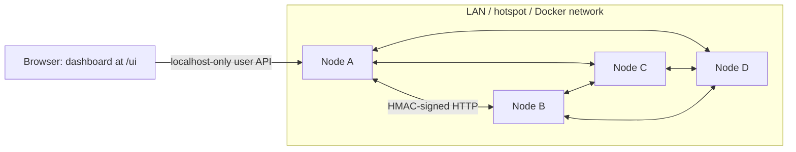

# Minimol Storage

**Store. Survive. Heal.** Peer-to-peer cloud storage across the laptops you already have.

Files are compressed and encrypted on your machine before they leave it. Each chunk is kept as 3 copies on 3 different laptops, and when a laptop dies the survivors re-copy its chunks automatically. There is no central server: every node runs the same program.

| | |
|---|---|
| **Client-side compression** | zstd level 3 per 1 MiB chunk. Each chunk stays compressed only if that saves ≥ 3%. |
| **Client-side encryption** | AES-256-GCM, with a fresh key per file. Peers only ever hold ciphertext. |
| **Replication** | 3 copies on 3 distinct hosts, chosen by tiered weighted rendezvous hashing. |
| **Smart routing** | Slow peers get no new chunks. Downloads ask the holder with the lowest estimated fetch time, and hedge to the next holder if a request stalls. |
| **Self-repair** | Heartbeats every 2 s. A silent peer is marked dead after 20 s, and an elected holder re-copies its chunks. |
| **Recovery** | A username + passphrase rebuilds the keys. A fresh laptop pulls the signed file list from peers. |
| **Delta sync** | Re-uploading a changed file sends only the changed chunks. |
| **Dashboard** | React app served by every node at `/ui`. |

## Measured results

From a 4-node Docker cluster on one laptop, with real encryption and compression and a simulated 300 ms slow node. Median of 5 runs; see [docs/RESULTS.md](docs/RESULTS.md).

| | |
|---|---|
| 20 MB CSV after compression + encryption | **0.30×** its size |
| Download, fastest holder vs random holder | **11.6×** faster (0.146 s vs 1.697 s) |
| Copies on the slow peer, smart vs random placement | **0%** vs 21.7% |
| Re-upload after a 1% append to 20 MB | **0.19 MB** sent |
| From a node dying to every chunk back at 3 copies | **about 20–40 s** |
| Tests | 164 passed, plus a live 4-node cluster test |

## Run it

### Docker (one machine, 4 nodes)

```bash
docker compose up -d --build
```

Open http://localhost:8001/ui/ and unlock with any username and a passphrase of 12+ characters. To break it, stop a node:

```bash
docker compose stop node3
```

Watch the dashboard: the node turns red after about 20 s, and the files heal shortly after.

To run the end-to-end check (cluster test + live benchmark):

```bash
scripts/docker_e2e.sh
```

More in [docs/DOCKER.md](docs/DOCKER.md).

### Real laptops (same Wi-Fi or hotspot)

```bash
python3 -m venv .venv && .venv/bin/pip install -r requirements.txt
(cd ui && npm ci && npm run build)          # dashboard, once per laptop
CLUSTER_KEY=<shared secret, 16+ chars> NODE_ID=laptop-1 HOST_ID=laptop-1 \
  SEEDS=<ip of any other laptop>:8000 .venv/bin/python -m node.main
```

Then open http://localhost:8000/ui/ on that laptop.

- **Firewall:** allow Python through it.
- **Check connectivity:** from another laptop, `curl http://<ip>:8000/health` must answer (any HTTP reply).
- **Fallback:** if laptops can't reach each other, use Docker on one laptop and say so.

### Tests and benchmark

```bash
.venv/bin/pip install -r requirements-dev.txt && .venv/bin/python -m pytest -q
python -m bench.bench --sim                  # checks the script only, not real numbers
python -m bench.bench --target http://127.0.0.1:8001 --username u --passphrase '...' --slow-node node-4 --kill-node node-2
```

## How it works



Every node has the same parts:
- **pipeline:** chunk, compress, encrypt, hash
- **routing:** tiered rendezvous placement, ETA retrieval, hedged reads
- **transfer:** upload, download, delta sync, recovery
- **repair loop**
- **peer API:** chunks, inventory, heartbeats, gossip, mDNS
- **chunk store:** atomic writes, quota

| Read | For |
|---|---|
| [docs/explain/](docs/explain/) | One page per part, written to be explained out loud |
| [docs/ARCHITECTURE_DECISIONS.md](docs/ARCHITECTURE_DECISIONS.md) | Every design choice, the strongest counter-argument, and the verdict |
| [docs/JUDGE_QA.md](docs/JUDGE_QA.md) | 100+ judge questions with answers, follow-ups and limits |
| [docs/DEMO_SCRIPT.md](docs/DEMO_SCRIPT.md) | The 5-minute live demo with fallbacks |
| [docs/RESULTS.md](docs/RESULTS.md) | All measurements and how they were taken |
| [docs/Minimol_Storage_Pitch.pptx](docs/Minimol_Storage_Pitch.pptx) | Pitch deck ([outline](docs/SLIDES.md)) |
| [docs/TEAM_WORKFLOW.md](docs/TEAM_WORKFLOW.md) | Who owns what, merge gates, fallbacks |

## Repository

```
node/        pipeline, keys, manifest, index (P1) · chunkstore, peers, api_peer, discovery (P2)
             routing, transfer, repair, api_user (P3) · main.py wires a node together
ui/          React dashboard (Vite + TypeScript)
bench/       bench.py: live and simulated benchmarks with A/B baselines
tests/       unit tests, fakes, and the live cluster test
scripts/     run_cluster.sh (local processes), docker_e2e.sh
docs/        explanations, decisions, Q&A, demo, results, deck
```

## Limits

- **One network today.** Internet-wide use needs a DHT and NAT traversal (planned).
- **Storage cost:** 3 full copies cost 3× before compression. Erasure coding is planned for 8+ nodes.
- **Cleanup:** extra copies are not garbage-collected yet.
- **Peer links:** they are signed but not TLS-encrypted. The data itself is already encrypted.
- **Delta sync** handles appends and in-place edits, not insertions. Content-defined chunking is planned.

## Team

| Role | Owns |
|---|---|
| P1 | Crypto + data: pipeline, keys, manifests, signed index, dashboard |
| P2 | Node + network: chunk store, peer API, heartbeats, inventory, discovery |
| P3 | Routing + repair: placement, retrieval, transfer, repair, user API, benchmark |
| P4 | Story + demo: explanations, Q&A, demo script, results, deck |
