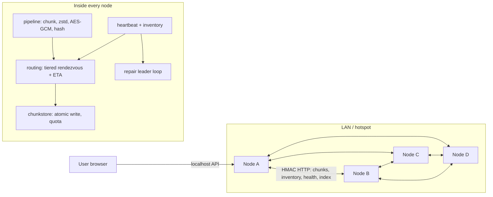

# P2P Cloud Storage: Architecture Decisions

How to read this file: each decision lists **Pick**, the strongest **Counter** against it, the **Defense**, and the **Verdict**. When a counter won, the design changed. Any feature marked *(planned)* is not in the MVP.

## 0. What the problem statement actually asks for

1. **Peer-to-peer storage with no central server.** Ordinary machines store pieces of each other's files.
2. **Client-side compression.** The uploader's machine compresses data before it leaves the machine.
3. **Smart routing.** The system picks good peers for storing data and fetching it back.
4. **Implied requirement: the system keeps working when a peer dies.** Judges will test this.

---

## 1. Network: LAN peer-to-peer, no internet NAT traversal

- **Counter:** "Standalone P2P cloud" suggests the system works across the internet. A LAN-only system looks like a toy.
- **Defense:** NAT traversal (getting connections through home and campus routers) can take the whole day, and it often fails on venue Wi-Fi. A demo that doesn't run scores zero.
- **Counter to the defense:** Then we can't answer the question "does it work across networks?"
- **Fix:** Nodes talk plain HTTP to IP addresses, so the same code runs over a mesh VPN such as Tailscale or ZeroTier. If needed, we can put one laptop on mobile data to show this. We must say on stage that the VPN handles the routing, not our code.
- **Verdict: KEEP LAN-first.** Roadmap: a Kademlia DHT plus relays.

## 2. Stack: Python 3.11, FastAPI, uvicorn, httpx, SQLite

- **Counter:** Python is slow. Go with libp2p would give us NAT traversal and a DHT for free.
- **Defense:** Wi-Fi bandwidth is the bottleneck, not Python. zstd, AES and SHA-256 all run in C underneath. libp2p takes too long to learn in one day. Every HTTP endpoint can be opened in a browser for debugging.
- **Verdict: KEEP.**

## 3. Pipeline: process each chunk separately, not the whole file

The original order was: whole file → compress → encrypt → split into chunks.

- **Counter to the original:**
  - The whole file sits in RAM.
  - The AES-GCM integrity check can only run after every chunk has downloaded.
  - Nothing limits decompression bombs.
  - Sampling the first 256 KB can misjudge whether a mixed file will compress.
- **New order:** split the file into 1 MiB plaintext chunks. Then, for each chunk: zstd level 3 (kept only if it saves ≥ 3%) → AES-256-GCM.
- **Counter to the new order:** Compressing chunks separately gives a slightly worse ratio, and each chunk carries 28 bytes of encryption overhead.
- **Defense:** zstd level 3 only looks back a few MB, so the loss should be small. That is an estimate, so **measure both modes** and show the result. In return we get:
  - an integrity check on every chunk,
  - memory usage limited to one chunk,
  - decompressed output capped at 1 MiB per chunk (`max_output_size`, see the [python-zstandard docs](https://python-zstandard.readthedocs.io/en/latest/decompressor.html)),
  - a separate compress-or-not decision per chunk, so mixed files are handled correctly.
- **Verdict: CHANGE to per-chunk processing.**

Details:
- The file is read and encoded one chunk at a time (`encode_chunk`), so the whole file is never in RAM.
- Each chunk's 96-bit nonce is **synthetic**: `HMAC-SHA256(nonce_key, compressed_flag || plaintext_chunk)[:12]`, where `nonce_key = HKDF-SHA256(DEK, info="minimol-2026/nonce/v1")`. A separate nonce key means the DEK is used only for AES-GCM. This enables delta sync (see §14).
- The AAD (data that is authenticated but not encrypted) is `file_uuid || compressed_flag`. This stops a chunk being moved into a different file. The chunk's position is protected by the ordered chunk list in the authenticated manifest.
- Stored blob = `nonce || ciphertext || tag`.
- Empty file = 0 chunks.
- A file whose size is an exact multiple of 1 MiB gets no trailing empty chunk.
- NIST limits random-nonce GCM to about 2^32 encryptions per key ([NIST workshop paper](https://csrc.nist.gov/csrc/media/Events/2023/third-workshop-on-block-cipher-modes-of-operation/documents/accepted-papers/Practical%20Challenges%20with%20AES-GCM.pdf)). We use a new key for every file, so we stay far below that.

## 4. Chunk ID = SHA-256 of the encrypted blob

- **Counter:** Every upload is encrypted with fresh random keys and nonces, so identical files are stored twice. There is no deduplication.
- **Alternative:** Convergent encryption, where the key is derived from the file content so identical files encrypt identically.
- **Counter to the alternative:** It lets anyone confirm whether a known file is stored. Tahoe-LAFS mixes a per-client "convergence secret" into the key for exactly this reason ([Tahoe-LAFS config docs](https://tahoe-lafs.readthedocs.io/en/latest/configuration.html)).
- **Verdict: KEEP hashing the ciphertext.** There is no deduplication *across users*. Deduplication *across versions of the same file* is added in §14. Also change `file_id` from `sha256(plaintext)` to a **random UUID**, because a plaintext hash leaks the same confirmation information. The plaintext SHA-256 is stored only inside the encrypted manifest.

## 5. Keys come from a passphrase, not a key file on one laptop

- **Counter to the original:** If the uploader's laptop dies, every file is lost, even though every chunk has 3 copies. That makes the redundancy claim false.
- **New design:**
  - `scrypt(passphrase, salt = owner_salt(username)) → master secret`. The salt is fixed by `node/contracts.py` as `SHA-256("minimol-2026/owner-salt/v1|" || username)`, so a fresh laptop needs no stored salt file. The username keeps two users with the same passphrase from getting the same keys.
  - The master secret produces two keys:
    - a **key-encryption key (KEK)**, which encrypts each file's data key and the manifests,
    - an **Ed25519 owner signing key**.
  - Each file gets a random data key (DEK), which is stored *encrypted* inside its manifest. New versions of the same file (same name, same owner) reuse the file's UUID and DEK.
- **Counter to the new design:** A weak passphrase can be guessed offline by anyone holding the encrypted manifests.
- **Defense:** Use expensive scrypt parameters and require at least 12 characters. Only cluster members can fetch manifests.
- **Verdict: CHANGE.** This enables the best demo moment: **a fresh laptop recovers every file using only the username and passphrase.**

## 6. Redundancy: 3 full copies (R = 3), not erasure coding

- **Counter:** Erasure coding survives the same number of failures with about half the storage.
- **Defense:** We have only 4 laptops. With a "2 of 4 pieces" scheme, every laptop holds one piece. When a laptop dies there is no fifth machine to rebuild on, so self-repair is impossible. Erasure coding would also cost 3–4 hours. Repairing a full copy needs just one download.
- **Counter to the defense:** 3 copies means 3× storage.
- **Defense:** Compression wins some of that back. Report stored bytes divided by original bytes, **as measured**.
- **Verdict: KEEP R = 3**, with a hard rule: **never place two copies on the same host.** Roadmap: erasure coding with zfec once we have 8 or more nodes.

**What R = 3 actually guarantees:** a chunk survives the loss of any 2 of its holders, but **only if** all of the following are true:
- all 3 copies were written to 3 different hosts,
- there is no silent corruption,
- the owner still has the passphrase.

Also note that a peer being reachable (availability) is not the same as the data being safe long-term (durability).

## 7. Chunk locations are soft state, and manifests never change

- **Counter to the original:** The holder lists lived inside the uploader's manifest. That meant only the uploader could run repair, and repair and uploads both rewrote the same manifest, which risks lost updates.
- **Alternative A: a coordinator that tracks locations.**
  - Counter: it is a single point of failure, which contradicts "standalone".
- **Alternative B: nodes learn locations from each other.** Every node pulls `GET /inventory` (the list of chunk IDs a peer holds) from each live peer every 10 s and builds a map of `chunk_id → peers` in memory.
  - Counter: each poll costs O(peers × chunks), so it won't scale to thousands of nodes.
  - Defense: this is fine for 10 nodes, and "DHT provider records" is the honest answer for larger scale. In return, manifests become **immutable** and repair no longer depends on the uploader.
- **Verdict: CHANGE to B.**

How metadata is stored:
- **Manifest:** encrypted under the KEK and stored as a content-addressed object with 3 copies, exactly like a chunk. It contains: file UUID, name, size, plaintext SHA-256, the encrypted data key, and the ordered list of chunk IDs, sizes and flags.
- **Owner index:** the owner's list of manifest IDs, stored at slot = the owner's public key as `{version, encrypted index}` and signed with Ed25519. Peers reject records with bad signatures and keep only the highest version.
- **File versions:** the index holds **one manifest ID per file** (the latest). Re-uploading a file with the same name reuses its UUID and DEK, writes a new manifest with `version + 1`, and replaces the old manifest ID in the index. Old manifests and chunks stay on peers until garbage collection (*planned*).
- **Known limits:**
  - Only one device should write the index at a time (a CRDT merge is *planned*).
  - A peer could return an older version (rollback). We reduce this by asking all holders and taking the highest valid version.

## 8. Placement: rendezvous hashing with fixed weights and two tiers

- **Counter 1 to the original:** Weights came from live scores, which change every few seconds. A chunk's "best 3 peers" would keep changing, so repair would copy chunks back and forth.
- **Counter 2:** With 4 nodes and 3 copies, every node holds about 75% of chunks regardless of score. Smart placement would be invisible.
- **Alternative: round-robin.**
  - Counter: it needs stored state, and every join or leave reshuffles placement. Rendezvous hashing moves the minimum number of chunks when membership changes, and it is about 15 lines of code ([IETF weighted HRW draft](https://datatracker.ietf.org/doc/html/draft-ietf-bess-weighted-hrw-01)).
- **New design:**
  - **Eligible peers:** alive, quota ≥ 2 MiB free, and a host_id that doesn't already hold a copy.
  - **Tier 1:** healthy peers. **Tier 2:** slow peers. A peer moves to tier 2 when its transfer-time average stays above 3× the cluster median for 30 s.
  - Within a tier, each peer's rank key is `-w / ln(u)`, where:
    - `u = (int.from_bytes(sha256(chunk_id + node_id)[:8]) + 0.5) / 2**64`, so `u` is strictly between 0 and 1,
    - `w` is a fixed capacity weight, always greater than 0.
  - Fill the 3 copies from tier 1 first. **Result in the demo: the slow peer gets 0 new chunks.**
- **About the original math:** `score * (-1/ln x)` *is* the correct weighted form. It breaks only when the score is ≤ 0, which the original formula allows. It can also hit `ln(0)` if the hash prefix is all zeros, and the comment calling its output "(0, 1]" was wrong.
- **Verdict: CHANGE.**

## 9. Retrieval routing: estimated fetch time, not a weighted sum

- **Counter to the original:** The weights 0.35 / 0.25 / 0.20 / 0.20 / −0.15 are arbitrary, the score can go negative, and heartbeat round-trip time doesn't predict how long a 1 MiB transfer takes.
- **New design:** rank the holders of a chunk by `ETA = rtt_ewma + chunk_size / bw_ewma`.
  - Both averages are exponentially weighted (α = 0.3) and come from **real chunk transfers**.
  - The result is in seconds, so there are no weights to defend.
  - A peer whose transfer just failed goes to the back of the line for 15 s.
- **Counter to the new design:** A new peer has no transfer history.
- **Defense:** Start new peers from the cluster median.
- **Option: hedged reads.** If a request takes longer than 2× its ETA, also ask the next holder and use whichever verified reply arrives first. This idea comes from Dean & Barroso, "The Tail at Scale" ([summary](https://blog.acolyer.org/2015/01/15/the-tail-at-scale/)). It adds load only for the slow outliers.
- **Verdict: CHANGE.** **Prove it with an A/B test:** ETA ordering vs picking a random holder, with one node given `SIMULATED_DELAY_MS=300`, 5 runs each, report the median and min/max.

## 10. Failure detection: fixed heartbeat thresholds

- **Counter:** Adaptive detectors such as phi-accrual are more accurate.
- **Defense:** For 4 nodes, fixed thresholds are easy to explain and easy to tune.
- **Settings:**
  - Heartbeat every 2 s.
  - **Suspect** after 2 missed heartbeats *or* the first failed transfer.
  - **Dead** after 20 s with no successful contact.
  - Connect timeout 1 s, so a closed laptop lid doesn't stall each chunk for 5 s.
- **Verdict: KEEP, with these changes.** A `/health` reply is **not** proof that a peer still stores its chunks.

## 11. Repair: driven by peers, not by the uploader

- **Counter to the original:** If the uploader is offline, nothing gets repaired.
- **New design:** Every 10 s, each node checks every chunk it holds and counts the chunk's live holders. If there are fewer than 3:
  1. The **leader** for that chunk is the live holder with the highest rendezvous key. Every holder computes the same leader.
  2. The leader picks the best eligible peer that doesn't hold the chunk.
  3. It sends `HEAD` to confirm the target is missing the chunk, then `PUT`s it, then `HEAD`s again to verify.
- **Counter to the new design:**
  - Peers may see the network differently, so two leaders could both copy the chunk.
  - The leader may itself be dead without anyone having noticed yet.
- **Defense:**
  - `PUT` is idempotent because chunks are content-addressed, so a duplicate copy is harmless. The chunk is over-replicated, **never** under-replicated.
  - If a chunk is still short after 2 rounds, the next-ranked holder takes over as leader.
  - Repair starts only after a peer has been dead for 20 s, so a flapping peer doesn't cause a storm of copies.
  - Concurrent repair copies per node are limited.
- **Honest limits:**
  - If only 2 hosts are alive, 3 copies on 3 different hosts is impossible. The chunk shows as **degraded**.
  - If every holder is gone, the chunk shows as **unavailable**. It is never hidden.
  - Extra copies are not deleted (garbage collection is *planned*).
- **Verdict: CHANGE.**

## 12. Security: cluster HMAC, quotas, no remote delete

- **Counter to the original:** With no authentication, anyone on the Wi-Fi can fill peers' disks or poison the peer table.
- **New design:**
  - Every peer request carries `HMAC-SHA256(cluster_key, method|path|node_id|ts|sha256(body))` and is accepted only within ±30 s of the timestamp. Signing `node_id` (the `X-Node` header) stops a captured request being replayed under another node's name.
  - Per-node disk quota; a full node returns `507`.
  - Body size caps: chunk ≤ 1 MiB + 64 B, upload ≤ 256 MiB, otherwise `413`. FastAPI and Starlette have no default cap ([starlette#2155](https://github.com/encode/starlette/issues/2155)).
  - No peer `DELETE` endpoint.
  - The user API listens on localhost only.
- **Counter:** One leaked laptop exposes the shared key.
- **Defense:** Per-node identities with mutual TLS are the better design (*planned*). The data itself is client-side encrypted, so a peer only ever holds ciphertext.
- **Verdict: CHANGE.**

| Threat | Mitigation | Status |
|---|---|---|
| Peer returns corrupted or fake chunk | Re-hash against chunk ID, then the GCM tag, then the whole-file SHA-256 | MVP |
| Unauthorized node joins | Cluster HMAC | MVP |
| Disk exhaustion or huge upload | Quota (507) and body caps (413) | MVP |
| Decompression bomb | `max_output_size = 1 MiB` per chunk | MVP |
| Index tampering or rollback | Ed25519 signature, take the highest version across holders | MVP (rollback only reduced) |
| Peer claims to store data it deleted | HEAD checks plus random GET-and-hash spot checks; `POST /audit` challenge | Spot checks MVP, audit *planned* |
| Fake free-space claims | Only verified stored copies count; a failed PUT starts a cooldown | MVP |
| Replay within 30 s | Only idempotent requests are affected | Acknowledged |
| Sybil attack | Closed membership via the cluster key | MVP (not open-network safe) |
| Traffic sniffing | Payloads are already ciphertext; TLS *planned* | Partial |

## 13. Discovery: seed list plus gossip, mDNS optional

- **Counter:** Venue Wi-Fi often blocks multicast and isolates clients from each other.
- **Verdict: CHANGE.**
  - A typed seed list, plus `GET /peers` gossip, so knowing one peer is enough to find all of them.
  - mDNS (zeroconf) is optional polish.
  - Bring our own hotspot.
  - Discovering a peer is not the same as being able to connect to it. A peer counts as alive only after an authenticated heartbeat succeeds.

## 14. Delta sync: re-uploading a changed file sends only the changed chunks

This is the same idea as our production delta OTA pipeline, which shipped a 21.6 MB app release as 0.41 MB by sending only changed files.

- **Pick:**
  - A new version of a file reuses that file's DEK.
  - Each chunk's nonce is `HMAC(nonce_key, flag || plaintext)[:12]` (nonce key derived from the DEK, see §3), so an unchanged chunk encrypts to exactly the same bytes and gets the same chunk ID.
  - Before uploading a chunk, check the location map. If the chunk already has ≥ 3 live copies on distinct hosts, skip it.
- **Counter 1: a deterministic nonce is dangerous with AES-GCM.**
  - GCM breaks only when one (key, nonce) pair encrypts *different* plaintexts.
  - Here the nonce is derived from the plaintext under a secret key, so the same nonce implies the same plaintext and the result is identical ciphertext.
  - A collision of the 96-bit truncation is the only failure mode, and its probability is negligible at our scale (about 2^-48 even with 2^24 chunks under one key).
  - This is the synthetic-IV idea behind deterministic AEAD (SIV, RFC 5297).
- **Counter 2: it leaks equality.**
  - True, and we say so: peers can see which chunks are unchanged between two versions of *the same owner's file*.
  - Nothing leaks across files or users, because each file has its own DEK.
- **Counter 3: an insertion shifts every later chunk, so fixed-size chunks stop matching.**
  - True. Delta sync helps appends and in-place edits, such as logs, CSVs and datasets.
  - Content-defined chunking (FastCDC) is the roadmap fix for insertions.
- **Counter 4: is this worth the time?** It costs about 1 hour, gives the team a differentiator nobody else will have, and its effect is easy to measure (bytes sent vs file size).
- **Verdict: ADD.** In the cut list it comes after repair.

---

## Counter to the whole idea: "Isn't this just a smaller Tahoe-LAFS?"

Partly, and we say so. None of the algorithms are new. Our contribution is:
- repair that doesn't depend on the uploader,
- routing with a measured comparison against a baseline,
- recovery on a new device from a passphrase,
- encrypted delta sync, our OTA experience applied to storage,
- all of it working live on 4 laptops, with numbers.

This is an engineering integration achievement, not an invention.

## Final architecture (one paragraph)

LAN peer-to-peer in Python. Each file is split into 1 MiB chunks, and each chunk is compressed with zstd, then encrypted with AES-GCM. The chunk ID is the SHA-256 of the ciphertext. Every chunk gets 3 copies on 3 different hosts. Placement uses fixed-weight rendezvous hashing with a slow tier. Downloads choose holders by estimated fetch time, with optional hedged reads. Manifests are encrypted, immutable and replicated. Each owner has a signed index, and keys come from a passphrase. Nodes learn chunk locations by pulling each other's inventories. Repair is run by an elected holder. Peers authenticate with a cluster HMAC. Synthetic nonces make re-uploads send only the changed chunks.

## Demo order (most valuable first)

1. Upload a file and show the **measured** compression.
2. Show the chunk map: each chunk on 3 different hosts.
3. Turn on the delay on one peer. It gets 0 new chunks, and downloads route around it. Show the A/B numbers.
4. Kill a peer. The download still works and the SHA-256 matches.
5. Repair brings every chunk back to 3 copies. Show the measured repair time.
6. Kill a second **original** holder. The download still works. This demonstrates durability, not just a lucky retrieval.
7. A fresh laptop recovers every file using only the username and passphrase.
8. Append rows to the log and re-upload. Only the changed chunks are sent; show measured bytes sent vs file size.

**If we're behind, cut in this order:** hedged reads → delta sync → passphrase recovery → mDNS → dashboard polish. **Never cut steps 4 and 5.**

## Sources

- [Tahoe-LAFS configuration](https://tahoe-lafs.readthedocs.io/en/latest/configuration.html): 3-of-10 encoding, happy = 7, convergence secret
- [Tahoe-LAFS 1.20.0 release](https://lists.tahoe-lafs.org/pipermail/tahoe-dev/2024-December/010111.html)
- [Storj forum: 29/80/110 and long-tail cancellation](https://forum.storj.io/t/distribution-of-erasure-pieces-of-one-segment/21082) (forum post, not official docs)
- [Kubo README](https://github.com/ipfs/kubo): recommends ≥ 6 GB RAM and 2 cores
- [Syncthing Local Discovery v4](https://docs.syncthing.net/specs/localdisco-v4.html): UDP 21027, 30–60 s interval
- [py-libp2p on PyPI](https://pypi.org/project/libp2p/0.8.1/): 0.8.1
- [python-zeroconf on PyPI](https://pypi.org/pypi/zeroconf): LGPL
- [PEP 784](https://peps.python.org/pep-0784/): `compression.zstd` added in Python 3.14 (we stay on 3.11 with `zstandard`)
- [AES-GCM practical challenges (NIST workshop)](https://csrc.nist.gov/csrc/media/Events/2023/third-workshop-on-block-cipher-modes-of-operation/documents/accepted-papers/Practical%20Challenges%20with%20AES-GCM.pdf)
- [IETF weighted HRW draft](https://datatracker.ietf.org/doc/html/draft-ietf-bess-weighted-hrw-01)
- [The Tail at Scale summary](https://blog.acolyer.org/2015/01/15/the-tail-at-scale/)
