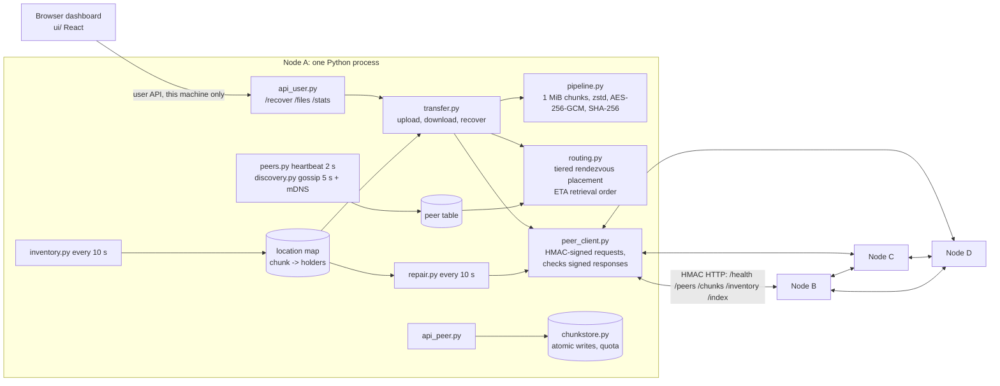

# 00 · Overview: Minimol Storage

**One line:** Minimol Storage turns a few ordinary laptops on one LAN into a shared, encrypted storage cluster, with no central server.

**Analogy:** Think of a group of friends who each keep a few sealed, numbered envelopes for each other. Nobody can read what's inside. If one friend leaves town, the others notice and make new copies of that friend's envelopes, so every envelope still has three keepers.

## The problem

The brief asks for four things ([ARCHITECTURE_DECISIONS.md §0](../ARCHITECTURE_DECISIONS.md#0-what-the-problem-statement-actually-asks-for)):

1. Peer-to-peer storage with no central server.
2. Compression on the uploader's machine, before data leaves it.
3. Smart routing: pick good peers to store on and to fetch from.
4. Implied: the system keeps working when a peer dies.

We added two things judges tend to ask about: recovery on a fresh laptop from a username and passphrase, and delta sync (re-uploading a changed file sends only the changed chunks).

## Architecture

Every laptop runs the same Python process ([node/main.py](../../node/main.py)). It serves two APIs on one port:

- the **peer API**, which other nodes call with HMAC-signed requests ([api_peer.py](../../node/api_peer.py)),
- the **user API** and the React dashboard, which answer only requests from this machine ([api_user.py](../../node/api_user.py), [main.py:88](../../node/main.py#L88)).

Four background loops run inside every node ([main.py:108](../../node/main.py#L108)): heartbeat every 2 s, gossip every 5 s, inventory every 10 s, and repair every 10 s. mDNS discovery runs too, best-effort.

What travels between nodes is always ciphertext: encrypted chunks, encrypted manifests, and a signed, encrypted owner index. Keys never leave the owner's machine.

## How a file moves through the system

1. The user unlocks the node with `POST /recover {username, passphrase}`. The node derives the owner's keys and pulls the owner's file list from peers ([api_user.py:127](../../node/api_user.py#L127)). See [07](07-recovery-and-keys.md).
2. Upload reads the file 1 MiB at a time. Each chunk is compressed (if it helps), encrypted and hashed ([transfer.py:100](../../node/transfer.py#L100)). See [01](01-pipeline.md).
3. Each chunk goes to 3 peers on 3 different hosts, chosen by tiered rendezvous hashing ([transfer.py:184](../../node/transfer.py#L184)). See [03](03-placement.md).
4. A sealed manifest (the file's recipe) is stored the same way, and a signed owner index is pushed to every alive peer ([transfer.py:331](../../node/transfer.py#L331)).
5. Download fetches chunks in ETA order with hedged reads, re-hashes every blob, decrypts, and checks the whole-file SHA-256 before serving it ([transfer.py:223](../../node/transfer.py#L223)). See [05](05-retrieval-routing.md).
6. If a node dies, heartbeats mark it dead after about 20 s, and the surviving holders copy its chunks elsewhere ([repair.py:74](../../node/repair.py#L74)). See [04](04-failure-detection.md) and [06](06-repair.md).

## The demo story

From [ARCHITECTURE_DECISIONS.md "Demo order"](../ARCHITECTURE_DECISIONS.md#demo-order-most-valuable-first):

1. Upload a 20 MB sensor CSV. Show the measured compression ratio.
2. Open the chunk map. Every chunk sits on 3 different hosts.
3. Turn on the simulated delay on one node. It gets 0 new chunks, and downloads route around it. Show the A/B numbers.
4. Kill a node. The download still works and the SHA-256 matches.
5. Watch repair bring every chunk back to 3 live copies.
6. Kill a second original holder. The download still works.
7. On a different node, unlock with the same username and passphrase. Every file comes back.
8. Append rows to the CSV and re-upload. Only the changed chunk is sent.

If the laptops can't reach each other, we run the same demo on Docker (`docker compose up -d`, see [DOCKER.md](../DOCKER.md)) and say so on stage.

## Evidence

- `pytest`: 171 passed, 1 skipped (the live cluster test, which needs a running cluster).
- [tests/test_cluster.py::test_upload_kill_download_repair_recover](../../tests/test_cluster.py#L46) covers demo steps 1–7 end to end. It passed against the Docker cluster and against [scripts/run_cluster.sh](../../scripts/run_cluster.sh).
- Docker cluster, 4 containers on one laptop, real encryption and compression, node-4 delayed 300 ms (simulated), 5 reps, medians:

| What | Result |
|---|---|
| 20 MB sensor CSV: encoded / original | 0.302 |
| 20 MB CSV: stored across 3 copies / original | 0.905 |
| 20 MB CSV: upload / download | 2.32 s / 0.147 s, SHA-256 match |
| 5 MB random bytes: ratio / stored vs original | 1.000 (stored raw) / 3.0 |
| Delta sync, append ~1% to 20 MB | 0.188 MB sent of 20.2 MB; 1 chunk sent, 20 reused |
| Share of copies on the slow node | tiered 0% vs random 21.7% |
| Retrieval: ETA order vs random holder | 0.146 s vs 1.697 s (11.6×) |
| Kill node-2: dead / back to 3 copies | 21.4 s / 21.4 s in that run |

Caveat: one machine, so these prove correctness, not Wi-Fi performance. The multi-laptop run is still to do.

## Map of the explanation docs

| Part | What it covers | Doc | Main code |
|---|---|---|---|
| Pipeline | Chunking, zstd, AES-256-GCM, synthetic nonce, hashing | [01-pipeline.md](01-pipeline.md) | [pipeline.py](../../node/pipeline.py) |
| Storage node | Chunk store, atomic writes, quota, peer API, HMAC | [02-storage-node.md](02-storage-node.md) | [chunkstore.py](../../node/chunkstore.py), [api_peer.py](../../node/api_peer.py), [auth.py](../../node/auth.py) |
| Placement | Tiered weighted rendezvous hashing, distinct hosts | [03-placement.md](03-placement.md) | [routing.py](../../node/routing.py) |
| Failure detection | Heartbeats, suspect/dead, slow tier, gossip, mDNS | [04-failure-detection.md](04-failure-detection.md) | [peers.py](../../node/peers.py), [discovery.py](../../node/discovery.py) |
| Retrieval routing | ETA ranking, cooldowns, hedged reads, A/B proof | [05-retrieval-routing.md](05-retrieval-routing.md) | [routing.py](../../node/routing.py), [transfer.py](../../node/transfer.py) |
| Repair | Leader, takeover, idempotent PUT, degraded state | [06-repair.md](06-repair.md) | [repair.py](../../node/repair.py) |
| Recovery and keys | Passphrase → keys, signed index, fresh device | [07-recovery-and-keys.md](07-recovery-and-keys.md) | [keys.py](../../node/keys.py), [index.py](../../node/index.py) |
| Security | Threat table, what AES-GCM does and doesn't cover | [08-security.md](08-security.md) | [auth.py](../../node/auth.py), [config.py](../../node/config.py) |
| Delta sync | Same file → same keys → unchanged chunks reused | [09-delta-sync.md](09-delta-sync.md) | [transfer.py](../../node/transfer.py) |
| Words | 30 terms in plain English | [GLOSSARY.md](GLOSSARY.md) | — |

The dashboard ([ui/src](../../ui/src)) is React + TypeScript. It polls `/stats`, `/files` and the chunk map every 2 s ([App.tsx:11](../../ui/src/App.tsx#L11)) and shows peers, files, the chunk map and repair events.

## Limits

- LAN only. No NAT traversal. A mesh VPN (Tailscale, ZeroTier) can carry the same HTTP traffic, but the VPN does the routing, not our code.
- Closed membership: one shared cluster key. Per-node identities with mutual TLS are (planned).
- 3 full copies, not erasure coding. Erasure coding is (planned) for 8+ nodes.
- No garbage collection of old versions or extra copies (planned).
- None of the algorithms are new. This is an integration project, and we say so.

## Judge questions

**Q: Isn't this just a smaller Tahoe-LAFS or IPFS?**
A: Partly, and we say so: the algorithms are known. What we built is repair that doesn't depend on the uploader, routing with a measured A/B against a baseline, passphrase recovery on a new device, and encrypted delta sync, all running live.
*Follow-up:* "So what's new?" → The integration and the measurements, not an algorithm.

**Q: Is there really no central server?**
A: Yes. Every node runs the same code, and any node can upload, download, repair or recover. Seeds are just addresses to start from; any live node can be a seed.
*Follow-up:* "What if the seed dies?" → Gossip and mDNS have already spread the full peer list, so a dead seed only matters to a node that has never joined.

**Q: What happens if two laptops die?**
A: Every chunk has 3 copies on 3 different hosts, so any 2 can go and the data is still readable. If repair finishes between the two failures, we are back to 3 copies, which is demo step 6.
*Follow-up:* "And three?" → With 4 nodes and 3 copies, losing 3 hosts at once can lose data. We don't claim otherwise.
